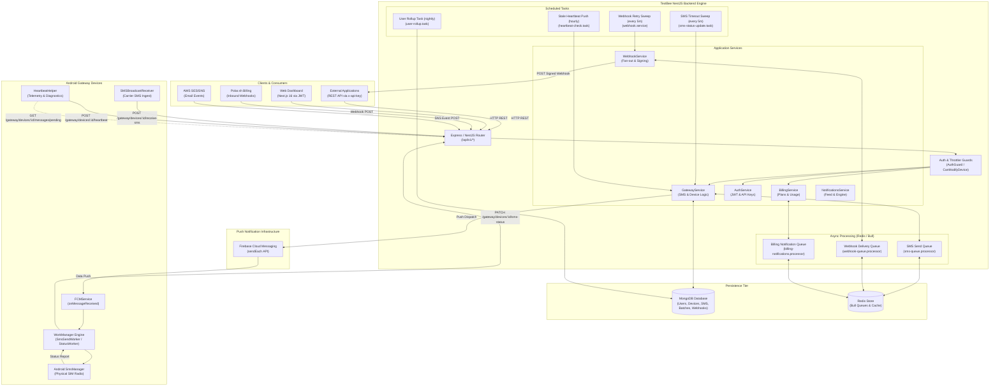

# TextBee System Architecture

## 1. High-Level Architecture

TextBee operates as an asynchronous, distributed gateway system. The core design challenge it addresses is turning consumer and enterprise Android hardware into highly reliable, programmatic SMS transmission relays while surviving Android's OS-level power optimizations, background execution constraints, and cellular carrier throttling.

View Mermaid Source

---

## 2. Subsystem Communication Flows

### 2.1. Inbound External API Request Flow
1. An external application initiates an HTTP POST request to `/api/v1/gateway/send-sms` with header `x-api-key: tb_...`.
2. `ThrottlerByIpGuard` extracts client IP via `resolveClientAddress` (inspecting reverse proxy headers) and checks rate limits (default: 500 requests per 60s per IP window).
3. `AuthGuard` extracts the key, executes SHA-256 hashing, performs an indexed lookup against the `ApiKey` collection, verifies active status, loads the linked `User` document, and attaches both to `req.user` and `req.apiKey`.
4. `GatewayController` parses `SendSMSRequestDTO`.
5. `GatewayService.resolveSenderDevice` selects the sending device:
   - If `deviceId` is provided in the body, validates ownership and loads the device.
   - If omitted, falls back to the account's configured `isDefault` device.
   - If no default is designated, selects the enabled device with the most recent `lastHeartbeat`.
   - If no active enabled device exists, terminates with HTTP 400 Bad Request.
6. Phone number format is validated via `assertValidRecipients` (rejecting alphabet characters and empty strings).
7. `BillingService.canPerformAction` queries daily and monthly quota counters. If limits are exceeded, aborts with HTTP 429 Too Many Requests.
8. A `SMSBatch` record is persisted with status `pending`.
9. Individual `SMS` documents are created for each recipient with status `pending`.

### 2.2. Dispatch & Transmission Pipeline (Backend to Android)

TextBee implements two dispatch pathways depending on Redis/Bull queue configuration:

#### Mode A: Asynchronous Bull Queue Dispatch (Production Recommended)
- If `smsQueueService.isQueueEnabled()` returns `true`:
  - `SMSBatch` is marked `processing`.
  - `planSendSmsJob` splits messages into waves based on `smsSendDelaySeconds` (default: 5 seconds per device) to avoid tripping mobile carrier spam caps.
  - The job is pushed to the Bull `sms-send` queue in Redis.
  - `SmsQueueProcessor` processes each wave, handing FCM messages to `firebaseAdmin.messaging().sendEach()`.
  - For scheduled sends (`scheduledAt`), Bull sets the job execution delay accordingly.

#### Mode B: Synchronous Direct Push (Queue Disabled)
- If Bull queue is not enabled:
  - The backend immediately constructs Firebase Cloud Messaging `Message` objects with a payload containing `{ smsData: JSON.stringify({ smsId, smsBatchId, message, recipients, simSubscriptionId }) }`.
  - Calls `firebaseAdmin.messaging().sendEach(fcmMessages)`.
  - Updates `sentSMSCount` on the `Device` document upon push acceptance.

### 2.3. On-Device Execution & Radio Transmission (Android)
1. `FCMService.onMessageReceived` parses `smsData` into `SMSPayload`.
2. `SmsDedupeStore` (Room SQLite) checks if `smsId` was previously processed to guarantee idempotency against duplicate pushes.
3. If valid, `SmsSendWorker` is enqueued via AndroidX `WorkManager`:
   - Enqueue mode is determined by `sendSchedulerV2Enabled` (delivered via device config).
   - In Paced mode (V2), `SendSlotScheduler` reserves execution slots spaced by `smsSendDelaySeconds`.
   - The worker executes with `OutOfQuotaPolicy.RUN_AS_NON_EXPEDITED_WORK_REQUEST` or expedited foreground notification on older Android versions.
4. `SmsSendWorker.resolveSim` determines which SIM slot to transmit on:
   - Evaluates `backendSimId` against active subscriptions via `SubscriptionManager`.
   - Falls back to app-level preferred SIM or system default SIM.
5. Invokes `android.telephony.SmsManager.sendTextMessage` (or `sendMultipartTextMessage` for long messages), registering `PendingIntent`s for `ACTION_SMS_SENT` and `ACTION_SMS_DELIVERED`.
6. Upon carrier response:
   - `ACTION_SMS_SENT` broadcast receiver captures Android result codes (`RESULT_OK`, `RESULT_ERROR_GENERIC_FAILURE`, `RESULT_ERROR_NO_SERVICE`, `RESULT_ERROR_RADIO_OFF`, etc.).
   - `SMSStatusUpdateWorker` enqueues an HTTP PATCH callback to `/api/v1/gateway/devices/:id/sms-status`.

### 2.4. Status Reporting & Webhook Fan-Out
1. Backend receives `PATCH /api/v1/gateway/devices/:id/sms-status`.
2. `decideStatusReport` runs the status state machine:
   - Moves message to `sent`, `delivered`, or `failed`.
   - If failed, records error code, error message, and appends to `issueHistory`.
   - If delivered, sets `deliveredAt`.
3. `batchStatus.refresh([sms.smsBatch])` recalculates batch counters (`successCount`, `failureCount`, `pendingCount`, `status`).
4. If status changed:
   - `WebhookService.deliverNotification` queries active `WebhookSubscription` records for matching events (`MESSAGE_SENT`, `MESSAGE_DELIVERED`, `MESSAGE_FAILED`).
   - For each matching subscription, creates a `WebhookNotification` record.
   - Enqueues a delivery job in Bull queue `webhook-queue`.
   - `WebhookQueueProcessor` executes HTTP POST with `X-Signature`, `X-Textbee-Timestamp`, and `X-Textbee-Signature` (v2 HMAC-SHA256).

### 2.5. Inbound SMS Pipeline
1. Incoming SMS arrives on the Android phone from the cellular carrier.
2. `SMSBroadcastReceiver` intercepts `android.provider.Telephony.SMS_RECEIVED`.
3. Verifies device configuration (`receiveSMSEnabled`).
4. Enqueues `SMSReceivedWorker` with message text, sender number, SIM subscription ID, and timestamp.
5. Android client calls `POST /api/v1/gateway/devices/:id/receive-sms`.
6. Backend `GatewayService.receiveSMS`:
   - Validates sender and body; returns `{ ignored: true }` if empty.
   - Evaluates billing quota (`canPerformAction(..., 'receive_sms', 1)`). If quota exceeded, sets `overLimit: true` but still persists the message.
   - Deduplicates within a ±5-second window against identical device, sender, and message.
   - Writes `SMS` document with `type: 'received'`, `status: 'received'`.
   - Emits `MESSAGE_RECEIVED` webhook event to active subscribers (unless the message was uploaded > 48 hours late).

---

## 3. Background Job Queues and Schedulers

| Queue Name | Processor File | Responsibility | Retry Policy |
|---|---|---|---|
| `sms-send` | `api/src/gateway/queue/sms-queue.processor.ts` | Paces outbound SMS push waves and handles delayed/scheduled messages. | Redis backed, Bull job retries. |
| `webhook-delivery` | `api/src/webhook/queue/webhook-queue.processor.ts` | Dispatches signed HTTP POST notifications to consumer webhooks. | Up to 10 delivery attempts with exponential backoff & jitter. |
| `billing-notifications` | `api/src/billing/queue/billing-notifications.processor.ts` | Dispatches email alerts when accounts approach usage limits (80%, 100%). | Single attempt with rate-limit dampening. |

### Scheduled Maintenance Cron Jobs (`@nestjs/schedule`)

1. **SMS Status Timeout Sweep (`SmsStatusUpdateTask`)**:
   - Runs every 5 minutes (`0 */5 * * * *`).
   - Finds SMS records stuck in `pending` or `dispatched` for > 20 minutes without phone updates.
   - Transitions their status to `unknown` and updates batch statistics.
2. **Stale Heartbeat Push (`HeartbeatCheckTask`)**:
   - Runs hourly (`0 0 * * * *`).
   - Scans for enabled devices that have not sent a heartbeat for > 30 minutes.
   - Sends a silent FCM push with `{ type: 'heartbeat_check' }` to wake the phone and prompt a heartbeat.
   - Flags devices with invalid/expired FCM tokens (`fcmTokenInvalidatedAt`).
3. **Webhook Retry Sweep (`WebhookService`)**:
   - Runs every 5 minutes (`0 */5 * * * *`).
   - Polls for `WebhookNotification` rows where `deliveredAt` is null and `nextDeliveryAttemptAt <= now`.
   - Re-enqueues jobs to Bull queue if worker instances were restarted.
4. **Auto-Disable Failing Webhooks (`WebhookService`)**:
   - Runs daily at 06:00 UTC (`0 6 * * *`).
   - Inspects webhooks with high failure rates (>90% failure over 50+ attempts) and pauses them (`isActive = false`).
5. **Nightly User Rollup (`UserRollupTask`)**:
   - Recomputes account aggregations (`deviceCount`, `apiKeyCount`, `totalSentSms`, `minAppVersionCode`).

---

## 4. Database Topology & Data Access Patterns

- **Engine:** MongoDB (Mongoose ODM).
- **Core Collections:**
  - `users`: User profiles, credentials, access telemetry, attribution, and rollups.
  - `devices`: Android gateway hardware profiles, FCM tokens, hardware specs, and telemetry.
  - `sms`: Sent and received SMS records, timing timestamps, error history, and SIM metadata.
  - `smsbatches`: Aggregated send batches tracking progress across multiple recipients.
  - `apikeys`: Masked keys, SHA-256 lookup hashes, bcrypt hashes, and usage counters.
  - `webhooksubscriptions`: Delivery endpoints, event masks, and signing secrets.
  - `webhooknotifications`: Delivery attempts, HTTP response statuses, payloads, and retries.
  - `plans`: Quota ceilings, pricing, and Polar product mapping.
  - `subscriptions`: Active and historical user subscription records synced from Polar.

