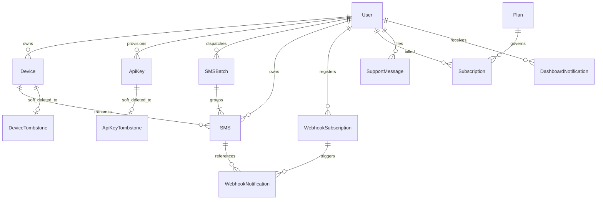

# TextBee Database & Entity Data Models

This document provides a comprehensive technical mapping of all database collections, Mongoose schema models, entity relationships, fields, types, default values, and compound indexes powering the TextBee SMS Gateway platform.

---

## 1. Entity-Relationship Overview

---

## 2. Core Entity Schemas

### 2.1 User Entity (`User`)
- **Source File:** [`user.schema.ts`](file:///e:/projects/textbee/api/src/users/schemas/user.schema.ts)
- **Collection Name:** `users`
- **Mongoose Decorator:** `@Schema({ timestamps: true })`

#### Field Catalog:

| Field Name | Type | Required | Default | Description & Constraints |
|---|---|---|---|---|
| `_id` | `ObjectId` | Auto | Generated | Primary MongoDB Key |
| `name` | `string` | No | `undefined` | User's full display name |
| `email` | `string` | Yes | - | Unique, lowercase email address |
| `googleId` | `string` | No | `undefined` | OAuth2 Google subject identifier (sparse, unique) |
| `avatar` | `string` | No | `undefined` | Profile picture URL |
| `phone` | `string` | No | `undefined` | Contact phone number (trimmed) |
| `password` | `string` | No | - | Bcrypt hashed password (`select: false`) |
| `role` | `string` | No | `'regular'` | Role enum: `'regular'`, `'admin'` |
| `lastLoginAt` | `Date` | No | `undefined` | Timestamp of latest login/token refresh |
| `emailVerifiedAt` | `Date` | No | `undefined` | Timestamp when email verification was completed |
| `emailVerificationWaivedAt` | `Date` | No | `undefined` | Operator-granted verification bypass (`select: false`) |
| `emailVerificationWaivedReason` | `string` | No | `undefined` | Operator rationale for verification bypass (`select: false`) |
| `isBanned` | `boolean` | No | `false` | Administrative account ban flag |
| `accountDeletionRequestedAt` | `Date` | No | `undefined` | Scheduled deletion grace period timestamp |
| `accountDeletionReason` | `string` | No | `undefined` | User-provided deletion feedback |
| `signupSource` | `string` | No | `undefined` | Normalized channel (`meta`, `reddit`, `google`, `direct`) |
| `signupDevice` | `string` | No | `undefined` | Device category on signup (`android`, `ios`, `desktop`) |
| `signupCountry` | `string` | No | `undefined` | Two-letter ISO country code at signup |
| `marketingOptIn` | `boolean` | No | `false` | Newsletter opt-in status |
| `client` | `UserClient` | No | `undefined` | Client browser & OS telemetry (`signup`, `last`) |
| `access` | `UserAccess` | No | `{}` | Summary of geolocations, IP footprints, and channels |
| `attribution` | `Attribution` | No | `undefined` | UTM campaign, referrer, and Meta `fbp` click tracking |
| `milestones` | `UserMilestones` | No | `{}` | `firstDeviceAt`, `firstApiKeyAt`, `firstSmsAt`, `firstPaidAt` |
| `rollup` | `UserRollup` | No | `{}` | Denormalized aggregations: `deviceCount`, `apiKeyCount`, `totalSentSms`, `minAppVersionCode` |
| `onboarding` | `object` | No | `{ currentStepId: 'verify_email' }` | Onboarding progress and skipped step tracking |
| `createdAt` | `Date` | Auto | Timestamp | Document creation timestamp |
| `updatedAt` | `Date` | Auto | Timestamp | Document update timestamp |

#### Indexes:
- `{ email: 1 }` (unique)
- `{ googleId: 1 }` (unique, sparse)
- `{ signupSource: 1, createdAt: -1 }`
- `{ signupCountry: 1, createdAt: -1 }`
- `{ 'access.countries': 1 }`
- `{ signupDevice: 1, createdAt: -1 }`
- `{ emailVerifiedAt: 1 }`
- `{ 'milestones.firstDeviceAt': 1 }`
- `{ 'milestones.firstSmsAt': 1 }`

---

### 2.2 Device Entity (`Device`)
- **Source File:** [`device.schema.ts`](file:///e:/projects/textbee/api/src/gateway/schemas/device.schema.ts)
- **Collection Name:** `devices`
- **Mongoose Decorator:** `@Schema({ timestamps: true })`

#### Field Catalog:

| Field Name | Type | Required | Default | Description & Constraints |
|---|---|---|---|---|
| `_id` | `ObjectId` | Auto | Generated | Primary MongoDB Key |
| `user` | `ObjectId` | Yes | - | References `User` document |
| `enabled` | `boolean` | No | `false` | Whether gateway operations are active on this device |
| `isDefault` | `boolean` | No | `false` | User's fallback gateway device |
| `fcmToken` | `string` | No | `undefined` | Firebase Cloud Messaging registration token |
| `fcmTokenUpdatedAt` | `Date` | No | `undefined` | When the push token was last registered |
| `fcmTokenInvalidatedAt` | `Date` | No | `undefined` | Timestamp if FCM returned `UNREGISTERED` |
| `fcmTokenInvalidReason` | `string` | No | `undefined` | Error description from Firebase Admin SDK |
| `brand` | `string` | No | `undefined` | Android hardware brand (`Build.BRAND`) |
| `manufacturer` | `string` | No | `undefined` | Android device manufacturer (`Build.MANUFACTURER`) |
| `model` | `string` | No | `undefined` | Model designation (`Build.MODEL`) |
| `name` | `string` | No | `undefined` | User-defined or auto-generated device name |
| `serial` | `string` | No | `undefined` | Hardware serial string |
| `buildId` | `string` | No | `undefined` | Android OS Build ID (`Build.ID`) |
| `os` | `string` | No | `undefined` | Platform OS (`"Android"`) |
| `osVersion` | `string` | No | `undefined` | Android version string (e.g. `"13"`, `"14"`) |
| `osApiLevel` | `number` | No | `undefined` | Android SDK level (`Build.VERSION.SDK_INT`) |
| `osVersionSource` | `string` | No | `undefined` | Enum: `'reported'`, `'fingerprint'`, `'buildId'` |
| `osBuildFingerprint` | `string` | No | `undefined` | Raw `Build.VERSION.BASE_OS` |
| `appVersionName` | `string` | No | `undefined` | TextBee Android app version (e.g. `"2.4.1"`) |
| `appVersionCode` | `number` | No | `undefined` | Integer version build code (e.g. `41`) |
| `sentSMSCount` | `number` | No | `0` | Cumulative successful outbound transmissions |
| `receivedSMSCount` | `number` | No | `0` | Cumulative inbound messages ingested |
| `heartbeatEnabled` | `boolean` | No | `true` | Periodic health telemetry enabled |
| `heartbeatIntervalMinutes` | `number` | No | `30` | Expected heartbeat interval in minutes |
| `receiveSMSEnabled` | `boolean` | No | `false` | Cellular SMS receive forwarder enabled |
| `smsSendDelaySeconds` | `number` | No | `5` | Pacing delay between queued sends on device |
| `lastHeartbeat` | `Date` | No | `undefined` | Timestamp of latest successful heartbeat |
| `batteryInfo` | `object` | No | `undefined` | `{ percentage: number, isCharging: boolean, lastUpdated: Date }` |
| `networkInfo` | `object` | No | `undefined` | `{ networkType: 'wifi' | 'cellular' | 'none', lastUpdated: Date }` |
| `memoryInfo` | `object` | No | `undefined` | `{ freeBytes: number, totalBytes: number, maxBytes: number, lastUpdated: Date }` |
| `storageInfo` | `object` | No | `undefined` | `{ availableBytes: number, totalBytes: number, lastUpdated: Date }` |
| `systemInfo` | `object` | No | `undefined` | `{ timezone: string, locale: string, lastUpdated: Date }` |
| `simInfo` | `object` | No | `undefined` | Multi-SIM carrier telemetry, slot indexes, signal levels |
| `powerInfo` | `object` | No | `undefined` | Doze mode, power saver, battery optimization whitelist |
| `appStateInfo` | `object` | No | `undefined` | Runtime permissions status (`SEND_SMS`, `READ_PHONE_STATE`) |
| `lastPendingPollAt` | `Date` | No | `undefined` | Timestamp of latest recovery poll |
| `createdAt` | `Date` | Auto | Timestamp | Document creation timestamp |
| `updatedAt` | `Date` | Auto | Timestamp | Document update timestamp |

#### Indexes:
- `{ user: 1 }`

---

### 2.3 SMS Entity (`SMS`)
- **Source File:** [`sms.schema.ts`](file:///e:/projects/textbee/api/src/gateway/schemas/sms.schema.ts)
- **Collection Name:** `sms`
- **Mongoose Decorator:** `@Schema({ timestamps: true })`

#### Field Catalog:

| Field Name | Type | Required | Default | Description & Constraints |
|---|---|---|---|---|
| `_id` | `ObjectId` | Auto | Generated | Primary MongoDB Key |
| `user` | `ObjectId` | Yes | - | References `User` document |
| `device` | `ObjectId` | Yes | - | References gateway `Device` document |
| `smsBatch` | `ObjectId` | No | `undefined` | References parent `SMSBatch` (if part of bulk send) |
| `message` | `string` | No | `undefined` | Plaintext SMS content |
| `encrypted` | `boolean` | No | `false` | Whether message body is AES encrypted |
| `encryptedMessage` | `string` | No | `undefined` | Encrypted ciphertext if enabled |
| `type` | `string` | Yes | - | Direction: `'outgoing'` or `'incoming'` |
| `sender` | `string` | No | `undefined` | Inbound message originator phone number |
| `recipient` | `string` | No | `undefined` | Outbound destination phone number (E.164) |
| `receivedAt` | `Date` | No | `undefined` | Telephony receipt timestamp on device (incoming) |
| `requestedAt` | `Date` | No | `undefined` | API submission timestamp |
| `dispatchDueAt` | `Date` | No | `undefined` | Scheduled wave delivery time (Bull delayed jobs) |
| `dispatchedAt` | `Date` | No | `undefined` | Timestamp when FCM push was handed to Google |
| `dispatchAttempts` | `number` | No | `undefined` | Number of times FCM push was attempted |
| `pushReceivedAt` | `Date` | No | `undefined` | Timestamp device acknowledged FCM push |
| `sendAttemptedAt` | `Date` | No | `undefined` | Timestamp Android invoked `SmsManager.sendTextMessage` |
| `sentAt` | `Date` | No | `undefined` | Carrier radio transmission acknowledgment (`RESULT_OK`) |
| `deliveredAt` | `Date` | No | `undefined` | Carrier cellular delivery report confirmation |
| `failedAt` | `Date` | No | `undefined` | Terminal failure timestamp |
| `errorCode` | `string` | No | `undefined` | Internal or Android error code |
| `errorMessage` | `string` | No | `undefined` | Human-readable failure explanation |
| `issueHistory` | `Array` | No | `undefined` | Audit trail of transient failures and delivery receipts |
| `status` | `string` | No | `'pending'` | Lifecycle state: `'pending'`, `'dispatched'`, `'sent'`, `'delivered'`, `'failed'`, `'unknown'`, `'received'` |
| `simSubscriptionId` | `number` | No | `undefined` | Target Android SIM subscription ID requested |
| `simUsed` | `SimUsed` | No | `undefined` | Actual carrier telemetry from SIM used |
| `overLimit` | `boolean` | No | `undefined` | Ingested while account was over quota |
| `metadata` | `object` | No | `undefined` | Internal diagnostics payload (`select: false`) |
| `createdAt` | `Date` | Auto | Timestamp | Record creation timestamp |
| `updatedAt` | `Date` | Auto | Timestamp | Record update timestamp |

#### Indexes:
- `{ device: 1, type: 1, receivedAt: -1 }`
- `{ user: 1, createdAt: -1, type: 1 }`
- `{ user: 1, createdAt: -1, _id: -1 }` (keyset pagination index)
- `{ device: 1, status: 1, requestedAt: -1 }` (pending recovery poll index)

---

### 2.4 SMS Batch Entity (`SMSBatch`)
- **Source File:** [`sms-batch.schema.ts`](file:///e:/projects/textbee/api/src/gateway/schemas/sms-batch.schema.ts)
- **Collection Name:** `smsbatches`
- **Mongoose Decorator:** `@Schema({ timestamps: true })`

#### Field Catalog:

| Field Name | Type | Required | Default | Description |
|---|---|---|---|---|
| `_id` | `ObjectId` | Auto | Generated | Primary MongoDB Key |
| `user` | `ObjectId` | Yes | - | References `User` document |
| `device` | `ObjectId` | No | `undefined` | Target gateway device |
| `message` | `string` | No | `undefined` | SMS text template |
| `recipientCount` | `number` | No | `undefined` | Total recipient count in batch |
| `recipientPreview` | `string` | No | `undefined` | Comma-separated preview of initial recipients |
| `successCount` | `number` | No | `0` | Messages confirmed `sent` or `delivered` |
| `failureCount` | `number` | No | `0` | Messages confirmed `failed` |
| `pendingCount` | `number` | No | `undefined` | Messages waiting in queue |
| `dispatchedCount` | `number` | No | `undefined` | Messages pushed to FCM |
| `sentCount` | `number` | No | `undefined` | Messages radio-transmitted |
| `deliveredCount` | `number` | No | `undefined` | Messages confirmed delivered by handset |
| `unknownCount` | `number` | No | `undefined` | Messages timed out by sweeper |
| `status` | `string` | No | `'pending'` | Batch state: `'pending'`, `'processing'`, `'completed'`, `'partial_success'`, `'failed'`, `'unknown'` |
| `error` | `string` | No | `undefined` | Batch failure description |
| `completedAt` | `Date` | No | `undefined` | Timestamp when final message finished |
| `statusCheckedAt` | `Date` | No | `undefined` | Last audit calculation timestamp |

#### Indexes:
- `{ user: 1, createdAt: -1 }`

---

### 2.5 API Key Entity (`ApiKey`)
- **Source File:** [`api-key.schema.ts`](file:///e:/projects/textbee/api/src/auth/schemas/api-key.schema.ts)
- **Collection Name:** `apikeys`
- **Mongoose Decorator:** `@Schema({ timestamps: true })`

#### Field Catalog:

| Field Name | Type | Required | Default | Description |
|---|---|---|---|---|
| `_id` | `ObjectId` | Auto | Generated | Primary MongoDB Key |
| `apiKey` | `string` | No | - | Masked prefix representation (e.g. `abc123******`) |
| `name` | `string` | No | `'API Key'` | Human-readable label |
| `hashedApiKey` | `string` | No | - | Bcrypt hash for legacy verification |
| `hashedApiKeySha256` | `string` | No | `undefined` | Deterministic SHA-256 hash for $O(1)$ fast lookup |
| `user` | `ObjectId` | Yes | - | References `User` document |
| `usageCount` | `number` | No | `0` | Lifetime authenticated request count |
| `lastUsedAt` | `Date` | No | `undefined` | Timestamp of latest authenticated request |
| `revokedAt` | `Date` | No | `undefined` | Revocation timestamp if destroyed |

#### Indexes:
- `{ apiKey: 1 }`
- `{ hashedApiKeySha256: 1 }` (unique, sparse)

---

### 2.6 Webhook Entities

#### WebhookSubscription (`WebhookSubscription`)
- **Source File:** [`webhook-subscription.schema.ts`](file:///e:/projects/textbee/api/src/webhook/schemas/webhook-subscription.schema.ts)
- **Collection Name:** `webhooksubscriptions`

| Field Name | Type | Default | Description |
|---|---|---|---|
| `user` | `ObjectId` | - | References `User` document |
| `name` | `string` | `undefined` | Optional subscription label (max 64 chars) |
| `isActive` | `boolean` | `true` | Subscription active status |
| `events` | `string[]` | `['sms.received']` | Subscribed event types |
| `deliveryUrl` | `string` | - | Target HTTPS endpoint URL |
| `signingSecret` | `string` | - | Secret for HMAC-SHA256 signature calculation |
| `successfulDeliveryCount`| `number` | `0` | Successful dispatch count |
| `deliveryFailureCount` | `number` | `0` | Consecutive failure count |
| `lastDeliverySuccessAt`| `Date` | `undefined`| Last successful 2xx response |
| `lastDeliveryFailureAt`| `Date` | `undefined`| Last failed response or timeout |
| `lastEnabledAt` | `Date` | `undefined`| Timestamp when re-enabled |
| `deletedAt` | `Date` | `undefined`| Soft-deletion timestamp |

**Indexes:**
- `{ user: 1, isActive: 1, events: 1 }`

#### WebhookNotification (`WebhookNotification`)
- **Source File:** [`webhook-notification.schema.ts`](file:///e:/projects/textbee/api/src/webhook/schemas/webhook-notification.schema.ts)
- **Collection Name:** `webhooknotifications`

| Field Name | Type | Description |
|---|---|---|
| `webhookSubscription` | `ObjectId` | References parent `WebhookSubscription` |
| `event` | `string` | Fired event name (e.g. `'sms.delivered'`) |
| `payload` | `object` | JSON payload sent to client URL |
| `sms` | `ObjectId` | Optional reference to triggered `SMS` |
| `deliveredAt` | `Date` | Confirmed receipt timestamp |
| `deliveryAttemptCount` | `number` | Number of attempts performed |
| `idempotencyKey` | `string` | Unique dispatch deduplication key |
| `httpStatusCode` | `number` | HTTP status code received from client server |
| `responseBody` | `string` | Truncated response body (max 1000 chars) |

**Indexes:**
- `{ sms: 1, event: 1, webhookSubscription: 1 }`
- `{ webhookSubscription: 1, createdAt: -1, _id: -1 }`

---

### 2.7 Billing & Subscription Entities

#### Plan (`Plan`)
- **Source File:** [`plan.schema.ts`](file:///e:/projects/textbee/api/src/billing/schemas/plan.schema.ts)
- Fields: `name` (`free`, `pro`, `custom`), `dailyLimit`, `monthlyLimit`, `bulkSendLimit`, `deviceLimit` (-1 unlimited), `webhookLimit`, `monthlyPrice` (cents), `yearlyPrice` (cents), `polarProductId`, `polarMonthlyProductId`, `polarYearlyProductId`, `isActive`.

#### Subscription (`Subscription`)
- **Source File:** [`subscription.schema.ts`](file:///e:/projects/textbee/api/src/billing/schemas/subscription.schema.ts)
- Fields: `user`, `plan`, `polarSubscriptionId`, `polarCustomerId`, `status` (`incomplete`, `trialing`, `active`, `past_due`, `canceled`, `unpaid`), `currentPeriodStart`, `currentPeriodEnd`, `cancelAtPeriodEnd`, `isActive`.

