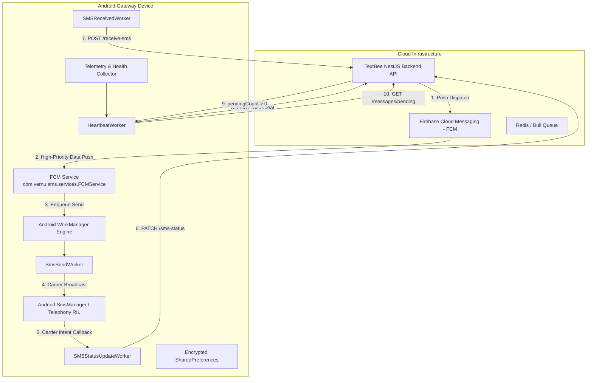
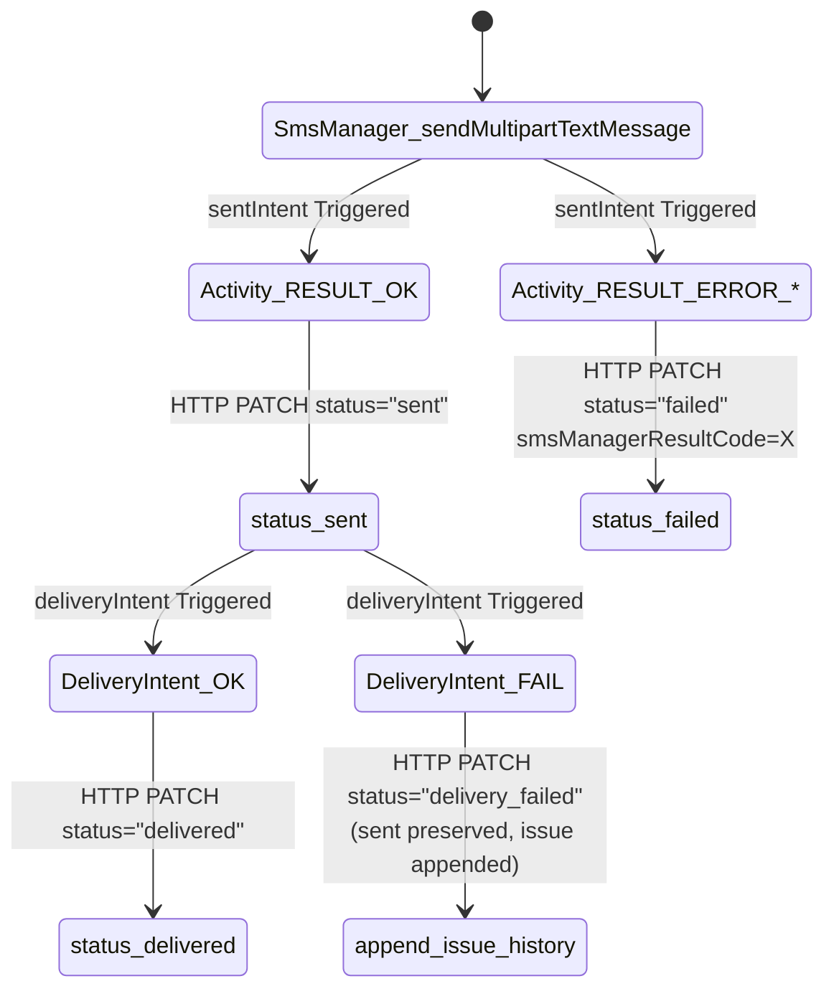

# TextBee Device Communication Protocol

This document details the bidirectional communication architecture between the TextBee backend API server and enrolled Android mobile devices acting as cellular SMS gateways.

---

## 1. Architectural Overview & Protocols

The TextBee device communication model uses an asymmetric bidirectional architecture:



| Direction | Primary Transport | Auxiliary Transport | Authentication / Security |
|---|---|---|---|
| **Downlink** (Server $\to$ Device) | Firebase Cloud Messaging (FCM) high-priority data messages | Poll-on-heartbeat recovery (`GET /devices/:id/messages/pending`) | FCM Registration Token stored in Device record; Firebase project service account |
| **Uplink** (Device $\to$ Server) | HTTPS REST API calls (Retrofit 2 + OkHttp 3) | None | `x-api-key: <user_api_key>` in request header |

---

## 2. Device Registration & Pairing Flow

### 2.1 Onboarding & Pairing States

Android enrollment is handled by [`OnboardingViewModel.kt`](file:///e:/projects/textbee/android/app/src/main/java/com/vernu/sms/ui/onboarding/OnboardingViewModel.kt):
1. **API Key Provisioning:** The user copies their API key from the Web Dashboard or scans a QR code generated by the dashboard.
2. **Device Identity Resolution:**
   - **New Device:** If not a returning user, the Android app does not supply a `deviceId`. The backend generates a MongoDB ObjectId.
   - **Existing Device Re-pairing:** If re-pairing an existing device record, the user enters the 24-character hexadecimal Device ID (`^[0-9a-fA-F]{24}$`).
3. **Google Play Services Check:** Validates Google Play Services availability using `GoogleApiAvailability.getInstance().isGooglePlayServicesAvailable(context)`. If missing or disabled, onboarding aborts with actionable guidance ([`RegistrationChecks.kt`](file:///e:/projects/textbee/android/app/src/main/java/com/vernu/sms/helpers/RegistrationChecks.kt#L29-L42)).
4. **FCM Token Acquisition:** Calls `FirebaseMessaging.getInstance().token` to retrieve the device push token.
5. **Hardware & SIM Telemetry Collection:** Compiles system properties (`Build.BRAND`, `Build.MANUFACTURER`, `Build.MODEL`, `Build.VERSION.RELEASE`, `Build.VERSION.SDK_INT`, `Build.VERSION.BASE_OS`) and SIM card info from `SubscriptionManager`.

### 2.2 Registration Payload (`RegisterDeviceInputDTO`)

Submitted to `POST /gateway/devices` (new device) or `PATCH /gateway/devices/:deviceId` (update):

```json
{
  "name": "Samsung Galaxy S22",
  "brand": "samsung",
  "manufacturer": "Samsung",
  "model": "SM-S901B",
  "buildId": "TP1A.220624.014",
  "os": "Android",
  "osVersion": "13",
  "osApiLevel": 33,
  "osBuildFingerprint": "samsung/sm-s901b/...",
  "appVersionName": "2.4.1",
  "appVersionCode": 41,
  "enabled": true,
  "fcmToken": "cK8...eR2:APA91bF...",
  "simInfo": {
    "lastUpdated": 1741305600000,
    "sims": [
      {
        "slotIndex": 0,
        "subscriptionId": 1,
        "carrierName": "T-Mobile",
        "displayName": "T-Mobile SIM 1",
        "countryIso": "us",
        "iccId": "8901260...",
        "number": "+15551234567"
      }
    ]
  }
}
```

### 2.3 Registration Response & Local Persistence

The backend responds with HTTP 201 (`POST`) or 200 (`PATCH`):

```json
{
  "success": true,
  "data": {
    "_id": "664b58e72c51080012abcdef",
    "name": "Samsung Galaxy S22",
    "heartbeatIntervalMinutes": 30,
    "enabled": true,
    "createdAt": "2026-03-01T10:00:00.000Z"
  }
}
```

Upon receipt, the Android app writes the following keys into `EncryptedSharedPreferences` / `SharedPreferenceHelper`:
- `SHARED_PREFS_DEVICE_ID_KEY` $\leftarrow$ `_id`
- `SHARED_PREFS_API_KEY_KEY` $\leftarrow$ User's API key
- `SHARED_PREFS_DEVICE_NAME_KEY` $\leftarrow$ `name`
- `SHARED_PREFS_HEARTBEAT_INTERVAL_MINUTES_KEY` $\leftarrow$ `heartbeatIntervalMinutes` (default: 30)
- `SHARED_PREFS_GATEWAY_ENABLED_KEY` $\leftarrow$ `true`

Immediately schedules the background heartbeat service via `HeartbeatManager.scheduleHeartbeat(context)`.

---

## 3. Downlink: Firebase Cloud Messaging (FCM)

### 3.1 Push Dispatch Architecture

The backend dispatches pushes using the Firebase Admin Node.js SDK ([`fcm.service.ts`](file:///e:/projects/textbee/api/src/modules/gateway/services/fcm.service.ts)):
- Uses `admin.messaging().sendEach(...)` for batched efficiency.
- All messages are **Data-Only Messages** (no `notification` payload block). This ensures `FCMService.onMessageReceived` is always triggered directly by the Android OS, even when the application is backgrounded or killed.
- Priority is set to `high` with Android config:
  ```typescript
  android: {
    priority: 'high',
    ttl: 3600 * 1000 // 1 hour TTL
  }
  ```

### 3.2 Outbound SMS Push Payload

Data payload key: `smsData` containing serialized JSON string:

```json
{
  "data": {
    "smsData": "{\"smsId\":\"664b58e72c51080012abcdef\",\"smsBatchId\":\"664b58e72c51080012abcd00\",\"message\":\"Your verification code is 492182.\",\"recipients\":[\"+15551234567\"],\"simSubscriptionId\":1}"
  }
}
```

#### Field Specifications:

| Key | Type | Description |
|---|---|---|
| `smsId` | `string` | MongoDB `_id` of the individual recipient SMS record |
| `smsBatchId` | `string` | MongoDB `_id` of the parent `SMSBatch` record |
| `message` | `string` | Plaintext body of the SMS |
| `recipients` | `string[]` | Array containing the recipient phone number (single recipient per push wave) |
| `simSubscriptionId` | `number?` | Optional Android carrier subscription ID for multi-SIM hardware routing |

### 3.3 Silent Heartbeat Trigger Push

The backend can trigger an out-of-band heartbeat from an enrolled phone by sending a silent wake-up push:

```json
{
  "data": {
    "type": "heartbeat_check"
  }
}
```

Upon receipt, `FCMService.kt` calls `HeartbeatHelper.sendHeartbeat(...)` and reschedules the periodic heartbeat worker.

### 3.4 FCM Token Refresh Lifecycle

When Google Play Services updates or rotates the device push token, `FCMService.onNewToken(token)` fires:
1. Android checks if `SHARED_PREFS_DEVICE_ID_KEY` and `SHARED_PREFS_API_KEY_KEY` are present.
2. Executes asynchronous HTTP PATCH via `GatewayApiService.updateDevice(...)`:
   ```json
   {
     "fcmToken": "<new_fcm_token>"
   }
   ```
3. Records `token_refreshed` event in local `DeviceLog`.

---

## 4. Device Telemetry & Heartbeat Protocol

### 4.1 Uplink: `POST /gateway/devices/:deviceId/heartbeat`

The device transmits rich hardware, power, OS, memory, and carrier telemetry at regular intervals (default: 30 minutes).

#### Complete Heartbeat Request Body:

```json
{
  "fcmToken": "cK8...eR2:APA91bF...",
  "batteryPercentage": 87,
  "isCharging": false,
  "networkType": "wifi",
  "appVersionName": "2.4.1",
  "appVersionCode": 41,
  "osVersion": "13",
  "osApiLevel": 33,
  "deviceUptimeMillis": 48291040,
  "memoryFreeBytes": 42991616,
  "memoryTotalBytes": 134217728,
  "memoryMaxBytes": 536870912,
  "storageAvailableBytes": 48318382080,
  "storageTotalBytes": 128000000000,
  "timezone": "America/New_York",
  "locale": "en_US",
  "receiveSMSEnabled": true,
  "smsSendDelaySeconds": 0,
  "isIgnoringBatteryOptimizations": true,
  "isDeviceIdleMode": false,
  "isPowerSaveMode": false,
  "hasSendSmsPermission": true,
  "hasReceiveSmsPermission": true,
  "hasReadPhoneStatePermission": true,
  "hasPostNotificationsPermission": true,
  "stickyNotificationEnabled": true,
  "usingLegacyUi": false,
  "simInfo": {
    "lastUpdated": 1741305600000,
    "sims": [
      {
        "slotIndex": 0,
        "subscriptionId": 1,
        "carrierName": "T-Mobile",
        "displayName": "T-Mobile",
        "countryIso": "us",
        "iccId": "8901260...",
        "number": "+15551234567"
      }
    ]
  }
}
```

#### Heartbeat Response & Synchronization:

```json
{
  "success": true,
  "fcmTokenUpdated": false,
  "name": "Samsung Galaxy S22",
  "pendingCount": 3,
  "config": {
    "recoveryPollEnabled": true,
    "heartbeatIntervalMinutes": 30
  }
}
```

#### Side Effects of Heartbeat on Android Device:
1. If `name` differs from local cache, synchronizes `SHARED_PREFS_DEVICE_NAME_KEY`.
2. Updates `SHARED_PREFS_LAST_HEARTBEAT_MS_KEY`.
3. Stores server config flags in `DeviceConfig`.
4. Evaluates `pendingCount`: If $> 0$ and recovery polling is active, triggers `RecoveryPoll.run(context, "heartbeat")`.

---

## 5. Missed Push Recovery Polling

On aggressive Android OEM skins (e.g., Xiaomi MIUI, Samsung OneUI, Huawei EMUI), Doze mode or aggressive battery management may delay or terminate FCM data pushes. TextBee implements an active polling recovery fallback.

### 5.1 Recovery Polling Guard Conditions ([`RecoveryPoll.kt`](file:///e:/projects/textbee/android/app/src/main/java/com/vernu/sms/helpers/RecoveryPoll.kt))

Recovery polling executes only when:
1. `DeviceConfig.recoveryPollEnabled(context) == true`.
2. Cooldown timer has elapsed: `now - lastPollMs >= 5 * 60 * 1000` (5 minutes).

### 5.2 Polling Endpoint: `GET /gateway/devices/:deviceId/messages/pending`

- **Endpoint:** `GET /gateway/devices/:deviceId/messages/pending`
- **Authentication:** `x-api-key: <user_api_key>`
- **Atomicity:** The backend atomically claims up to 25 pending messages whose `status == 'pending'` or `status == 'dispatched'` with `deliveryStatus == 'pending'`, marking them as claimed to prevent dual-processing.

#### Response Body:

```json
{
  "success": true,
  "data": [
    {
      "smsId": "664b58e72c51080012abcdef",
      "smsBatchId": "664b58e72c51080012abcd00",
      "message": "Security code: 591023",
      "recipients": ["+15551234567"],
      "simSubscriptionId": 1
    }
  ]
}
```

For each claimed message, `RecoveryPoll.run()` enqueues a new `SmsSendWorker` job in Android `WorkManager`.

---

## 6. Local Queueing & Deduplication

### 6.1 Android WorkManager Architecture

Outbound sending and status uploads are delegated entirely to Android `WorkManager`:

| Worker Class | Work Type | Constraints | Deduplication Key / Policy |
|---|---|---|---|
| [`SmsSendWorker`](file:///e:/projects/textbee/android/app/src/main/java/com/vernu/sms/workers/SmsSendWorker.kt) | One-time | None | Unique task per recipient; guarded by Room `SmsDedupeStore` |
| [`SMSStatusUpdateWorker`](file:///e:/projects/textbee/android/app/src/main/java/com/vernu/sms/workers/SMSStatusUpdateWorker.kt) | One-time | `NetworkType.CONNECTED` | `sms_status_<smsId>_<status>` with `ExistingWorkPolicy.KEEP` |
| [`SMSReceivedWorker`](file:///e:/projects/textbee/android/app/src/main/java/com/vernu/sms/workers/SMSReceivedWorker.kt) | One-time | `NetworkType.CONNECTED` | `sms_received_<fingerprint>` with `ExistingWorkPolicy.KEEP` |
| [`HeartbeatWorker`](file:///e:/projects/textbee/android/app/src/main/java/com/vernu/sms/workers/HeartbeatWorker.kt) | Periodic | None (handles offline gracefully) | `ExistingPeriodicWorkPolicy.UPDATE` |

### 6.2 Idempotency Store (`SmsDedupeStore`)

To prevent duplicate cellular SMS transmissions when FCM pushes arrive multiple times or race with recovery polling:
- Stored in Room database: [`SmsDedupeStore.kt`](file:///e:/projects/textbee/android/app/src/main/java/com/vernu/sms/database/SmsDedupeStore.kt).
- Composite key: `(smsId, recipient)`.
- Before invoking `SmsManager.sendTextMessage(...)`, the worker queries `smsDedupeDao.hasSent(smsId, recipient)`.
- If already recorded as sent within a 48-hour window, the transmission is skipped and immediately treated as successful.

---

## 7. Status Acknowledgment & Error Reporting

### 7.1 Uplink: `PATCH /gateway/devices/:deviceId/sms-status`

Dispatched via `SMSStatusUpdateWorker` following intent callbacks from the Android Telephony subsystem.

#### Status Update Payload:

```json
{
  "smsId": "664b58e72c51080012abcdef",
  "status": "sent",
  "statusCode": 0,
  "failureReason": null,
  "smsManagerResultCode": -1,
  "platformErrorCode": 0,
  "simSlotUsed": 0,
  "simSubscriptionIdUsed": 1,
  "reportedAt": 1741305602410,
  "reportAttempt": 1,
  "queueWaitMillis": 340,
  "sentWaitMillis": 1250,
  "radioSentWaitMillis": 910
}
```

#### Telephony Result Mappings:



### 7.2 Worker Retry Policy (`WorkerRetryPolicy.kt`)

For all network transmissions from the device to the server:
- **Max Retry Count:** 26 attempts (`MAX_ATTEMPTS = 26`).
- **Backoff Criteria:** Exponential backoff, initial delay 10 seconds.
- **Retry Conditions:**
  - Network disconnection or `IOException` (`responseCode == null`).
  - HTTP 408 (Request Timeout).
  - HTTP 429 (Rate Limited / Too Many Requests).
  - HTTP 500, 502, 503, 504 (Server Errors).
- **Non-Retriable Failures:** HTTP 400, 401, 403, 404, 422. Aborts immediately to prevent futile battery drain.

---

## 8. Inbound SMS Forwarding

When an incoming SMS broadcast is captured by `SMSBroadcastReceiver.kt`:
1. Constructs a message fingerprint: `SHA256(sender + message + timestamp)`.
2. Checks local Room deduplication table.
3. Enqueues `SMSReceivedWorker` with unique tag `sms_received_<fingerprint>`.
4. Executes HTTP POST to `POST /gateway/devices/:deviceId/receive-sms`:
   ```json
   {
     "sender": "+15559876543",
     "message": "Reply YES to confirm",
     "receivedAt": 1741305615000,
     "fingerprint": "a94a8fe5ccb19ba61c4c0873d391e987982fbbd3",
     "simSlotUsed": 0,
     "simSubscriptionIdUsed": 1
   }
   ```
5. The backend checks for duplicate messages within a 5-second window on the same device, persists the incoming record, and triggers any registered `sms.received` webhooks.

---

## 9. Device Connectivity & Liveness Tracking

Device online/offline state is tracked asynchronously by the backend:

1. **Heartbeat Refresh:** Every incoming heartbeat updates `device.lastSeenAt = new Date()`, sets `device.status = "online"`, and clears transient connection alerts.
2. **Server Background Sweeper (`DeviceStatusTask`):**
   - Scheduled cron job runs every 5 minutes.
   - Evaluates all active devices:
     $$\text{isOffline} = \text{now} - \text{lastSeenAt} > (\text{heartbeatIntervalMinutes} \times 2 \times 60 \times 1000)$$
   - If offline, transitions `device.status = "offline"`.
   - Dispatches `device.offline` webhook notifications if configured.

