# TextBee Errors, Status Codes & State Transitions

This document provides a comprehensive technical catalog of all message statuses, lifecycle state machines, Android telephony error codes, radio layer failure codes, and server API error structures within the TextBee platform.

---

## 1. Message Lifecycle State Machine

TextBee models SMS lifecycles through discrete state machines for outbound and inbound messages:

```mermaid
stateDiagram-v2
    [*] --> pending: API Request Accepted

    pending --> dispatched: Bull Queue Pops & FCM Push Sent
    pending --> failed: Validation / Quota / Device Inactive

    dispatched --> sent: Android sentIntent (RESULT_OK)
    dispatched --> failed: Android Error (Radio off, No credit, etc.)
    dispatched --> unknown: Cron Sweep (> 20 min without receipt)

    sent --> delivered: Android deliveryIntent (RESULT_OK)
    sent --> append_issue: Android deliveryIntent (RESULT_CANCELED)<br/>Status remains 'sent'; issueHistory appended

    unknown --> sent: Late Arrival sentIntent callback
    unknown --> delivered: Late Arrival deliveryIntent callback

    %% Inbound path
    [*] --> received: Android SMSBroadcastReceiver Ingest
```



### 1.1 Outbound Message Status Catalog

| Status Code | Description | Transitions Allowed From | Terminal State? | Notes |
|---|---|---|---|---|
| `pending` | Message record persisted in MongoDB; queued in Bull queue or waiting for scheduled wave | Initial | No | Bull job will push to FCM |
| `dispatched` | Successfully dispatched to Google FCM Admin SDK | `pending` | No | Awaiting Android push receipt and radio dispatch |
| `sent` | Android cellular radio confirmed carrier transmission (`RESULT_OK`) | `dispatched`, `unknown` (late arrival) | No | Awaiting optional carrier delivery report |
| `delivered` | Recipient handset carrier delivered PDU acknowledgment | `sent`, `dispatched`, `unknown` (late arrival) | Yes | Final successful state |
| `failed` | Permanent failure before or during transmission | `pending`, `dispatched`, `sent` | Yes | Carries `errorCode` and `errorMessage` |
| `unknown` | Timeout sweep: no Android callback received within 20 minutes | `pending`, `dispatched` | No | Set by `SmsStatusUpdateTask`; recoverable if device checks in |

### 1.2 Inbound Message Status Catalog

| Status Code | Description | Direction | Notes |
|---|---|---|---|
| `received` | Cellular SMS captured by Android broadcast receiver and posted to API | Inbound | Persisted in `SMS` collection with `type = 'incoming'` |

---

## 2. Android Telephony & Result Codes

When the Android application executes `SmsManager.sendTextMessage(...)` or `SmsManager.sendMultipartTextMessage(...)`, Android broadcasts PendingIntents for transmission and delivery.

### 2.1 Standard SmsManager Result Codes ([`SMSStatusReceiver.kt`](file:///e:/projects/textbee/android/app/src/main/java/com/vernu/sms/receivers/SMSStatusReceiver.kt))

| Constant | Int Value | TextBee Behavior / Error Message | Server Status Mapping |
|---|---|---|---|
| `Activity.RESULT_OK` | `-1` | Message successfully transmitted to carrier cell tower | `sent` |
| `SmsManager.RESULT_ERROR_GENERIC_FAILURE` | `1` | *"SMS failed on device. Common causes: no SMS credit on SIM, weak signal, or carrier blocked. Check SIM balance and signal, then try again."* (Appends carrier radio code if available) | `failed` |
| `SmsManager.RESULT_ERROR_RADIO_OFF` | `2` | *"Mobile radio is off (e.g. airplane mode). Turn off airplane mode and ensure cellular is on."* | `failed` |
| `SmsManager.RESULT_ERROR_NULL_PDU` | `3` | *"Message could not be sent; invalid format or carrier issue. Try a shorter message or different recipient."* | `failed` |
| `SmsManager.RESULT_ERROR_NO_SERVICE` | `4` | *"No cellular service. Check signal and try again when you have coverage."* | `failed` |
| `SmsManager.RESULT_ERROR_LIMIT_EXCEEDED` | `5` | *"Device/carrier send limit reached (too many SMS in a short time). Wait a few minutes or lower the send rate."* | `failed` |
| `SmsManager.RESULT_ERROR_FDN_CHECK_FAILURE` | `6` | Fixed Dialing Number (FDN) failure | `failed` |
| `SmsManager.RESULT_ERROR_SHORT_CODE_NOT_ALLOWED` | `7` | *"The phone asked whether textbee may text this short code, and the request was denied. In Android settings, open Special app access > Premium SMS access and set textbee to Always allow."* | `failed` |
| `SmsManager.RESULT_ERROR_SHORT_CODE_NEVER_ALLOWED`| `8` | *"textbee is blocked from texting short codes on this phone. In Android settings, open Special app access > Premium SMS access and set textbee to Always allow."* | `failed` |
| `SmsManager.RESULT_RADIO_NOT_AVAILABLE` | `9` | Radio daemon unavailable | `failed` |
| `SmsManager.RESULT_NETWORK_REJECT` | `10` | Cellular network rejected transmission | `failed` |
| `SmsManager.RESULT_INVALID_ARGUMENTS` | `11` | Invalid PDU or recipient argument | `failed` |
| `SmsManager.RESULT_INVALID_STATE` | `12` | Telephony state invalid | `failed` |
| `SmsManager.RESULT_NO_MEMORY` | `13` | SIM card or modem out of memory | `failed` |
| `SmsManager.RESULT_INVALID_SMS_FORMAT` | `14` | Corrupted PDU format | `failed` |
| `SmsManager.RESULT_SYSTEM_ERROR` | `15` | Android OS telephony system failure | `failed` |
| `SmsManager.RESULT_MODEM_ERROR` | `16` | Cellular modem firmware error | `failed` |
| `SmsManager.RESULT_NETWORK_ERROR` | `17` | *"Network error while sending. Check signal and try again."* | `failed` |
| `SmsManager.RESULT_ENCODING_ERROR` | `18` | Character encoding failure | `failed` |
| `SmsManager.RESULT_OPERATION_NOT_ALLOWED` | `20` | Telephony operation blocked by carrier | `failed` |
| `SmsManager.RESULT_INTERNAL_ERROR` | `21` | Android internal telephony service exception | `failed` |
| `SmsManager.RESULT_NO_RESOURCES` | `22` | Insufficient hardware resources | `failed` |
| `SmsManager.RESULT_CANCELLED` | `23` | Operation cancelled by user or subsystem | `failed` |
| `SmsManager.RESULT_REQUEST_NOT_SUPPORTED` | `24` | Carrier SIM does not support text format | `failed` |

### 2.2 RIL Radio Error Codes (Radio Interface Layer)

Extracted via `intent.getIntExtra("errorCode", -1)` when `RESULT_ERROR_GENERIC_FAILURE` occurs. Common Android RIL constants:

| RIL Code | Identifier | Explanation |
|---|---|---|
| `1` | `RADIO_NOT_AVAILABLE` | Radio layer crashed or resetting |
| `2` | `GENERIC_FAILURE` | Modem rejected AT command |
| `3` | `PASSWORD_INCORRECT` | SIM PIN / PUK required |
| `6` | `REQUEST_NOT_SUPPORTED` | Multi-part or SMS format rejected |
| `100` | `OEM_ERROR_BASE` | OEM-specific telephony error (e.g. Samsung/Qualcomm) |
| `101` | `NO_CREDIT` | Prepaid balance exhausted (carrier-specific signaling) |
| `102` | `NETWORK_BLOCKED` | Anti-spam or carrier-side throttling active |

---

## 3. Application & Pre-Radio Error Codes

Encountered on the Android device before `SmsManager` is called ([`SMSHelper.kt`](file:///e:/projects/textbee/android/app/src/main/java/com/vernu/sms/helpers/SMSHelper.kt)):

| Error Code | Origin | Description | User Action Required |
|---|---|---|---|
| `PERMISSION_DENIED` | [`SMSHelper.reportPermissionError`](file:///e:/projects/textbee/android/app/src/main/java/com/vernu/sms/helpers/SMSHelper.kt#L114-L139) | App lacks `SEND_SMS` or `READ_PHONE_STATE` Android runtime permission | Open Android Settings $\to$ Apps $\to$ TextBee $\to$ Permissions $\to$ Enable SMS |
| `SENDING_EXCEPTION` | [`SMSHelper.reportSendingError`](file:///e:/projects/textbee/android/app/src/main/java/com/vernu/sms/helpers/SMSHelper.kt#L141-L162) | Java/Kotlin unhandled exception thrown during SmsManager dispatch | Inspect device system log (`logcat`) |
| `PUSH_INVALID` | [`FCMService.onMessageReceived`](file:///e:/projects/textbee/android/app/src/main/java/com/vernu/sms/services/FCMService.kt#L97) | Push message missing `smsId`, `message`, or `recipients` | Backend serialization check |

---

## 4. Delivery Report Nuances & Issue History

Android carriers handle SMS delivery reports inconsistently:
- **`Activity.RESULT_OK` on deliveryIntent:** The carrier confirmed delivery. TextBee transitions the message status to `delivered`.
- **`Activity.RESULT_CANCELED` on deliveryIntent:** Many carriers (especially virtual network operators or prepaid SIMs) do not support delivery acknowledgments and cancel the pending intent.
- **TextBee Non-Downgrade Policy:**
  - If a message has already reached `sent` status, receiving `delivery_failed` does **not** revert the message status to `failed`.
  - Instead, the status remains `sent`, and an audit entry is appended to the message's `issueHistory` array:
    ```json
    {
      "code": "0",
      "message": "Delivery report was canceled (e.g. carrier does not support delivery receipts). Message may still have been delivered.",
      "at": "2026-03-01T12:00:05.120Z",
      "source": "android_delivery_report",
      "deliveryReport": true
    }
    ```

---

## 5. Server API Error Structures

All TextBee REST API error responses adhere to standard NestJS HTTP exception formats.

### 5.1 Standard Error Format

```json
{
  "success": false,
  "statusCode": 400,
  "error": "Bad Request",
  "message": "Invalid recipient phone number format. Must comply with E.164."
}
```

### 5.2 Array of Validation Errors (DTO Validation)

```json
{
  "success": false,
  "statusCode": 400,
  "error": "Bad Request",
  "message": [
    "recipients must contain at least 1 elements",
    "message should not be empty"
  ]
}
```

### 5.3 Common HTTP Status Codes

| Status Code | Meaning | Common Scenarios in TextBee |
|---|---|---|
| `200 OK` | Success | Successful GET, PATCH, DELETE operations |
| `201 Created` | Created | Successful POST creation (SMS sent, Device registered, API key created) |
| `400 Bad Request` | Client Error | Malformed body, missing parameters, invalid phone numbers |
| `401 Unauthorized` | Auth Failure | Missing, malformed, or invalid API key / JWT session |
| `402 Payment Required` | Quota Exceeded | Daily, monthly, or bulk plan limit exceeded |
| `403 Forbidden` | Access Denied | Operating on another user's device (`CanModifyDevice`), unverified email |
| `404 Not Found` | Resource Missing | Non-existent `smsId`, `deviceId`, or user |
| `409 Conflict` | State Conflict | Duplicate unique entity (e.g. active webhook with duplicate endpoint) |
| `429 Too Many Requests`| Throttled | IP-based rate limiting exceeded (`ThrottlerByIpGuard`) |
| `500 Server Error` | Internal Failure | Unhandled server exception, database disconnect |
| `502 / 503 Bad Gateway`| Dependency Error | Redis Bull queue down, Firebase FCM service unreachable |

