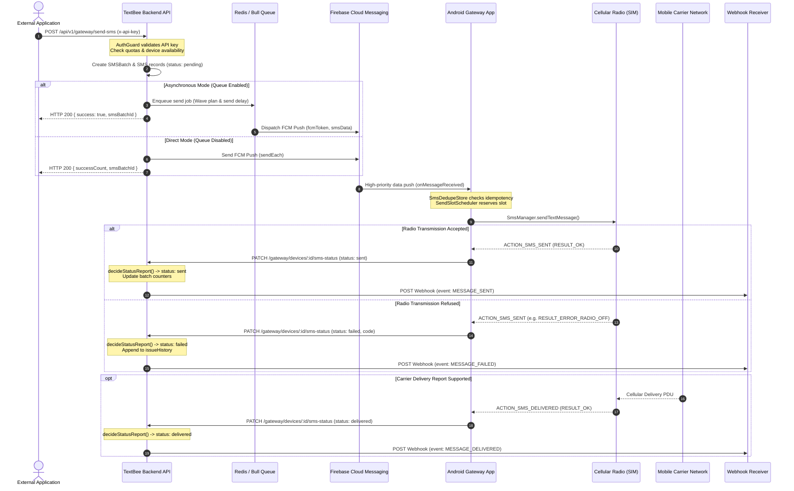
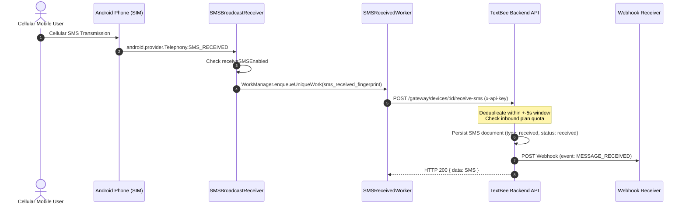

# TextBee SMS Messaging Lifecycle

This document provides a comprehensive, end-to-end trace of how SMS messages flow through TextBee, covering both outbound transmission and inbound reception, multi-SIM routing, retry behaviors, and state machine transitions.

---

## 1. Outbound SMS Transmission Lifecycle

The outbound SMS lifecycle spans external API clients, the backend orchestration engine, Google Firebase Cloud Messaging, Android WorkManager background tasks, and physical cellular radio transceivers.



---

## 2. Step-by-Step Outbound Phase Breakdown

### Step 1: Request Ingestion & Validation
1. An external client submits `POST /api/v1/gateway/send-sms` with an API key.
2. `AuthGuard` hashes the key with SHA-256 and retrieves the associated `User`.
3. `GatewayService.resolveSenderDevice` picks the active device:
   - Evaluates explicit `deviceId` if present.
   - Falls back to `isDefault: true` device on the account.
   - Falls back to device with newest `lastHeartbeat`.
   - Validates that `device.enabled === true`.
4. `assertValidRecipients` validates recipient phone numbers:
   - Strips whitespace.
   - Strictly rejects letters, punctuation names, or template artifacts.
5. Quota check: `BillingService.canPerformAction(userId, 'send_sms', count)` verifies daily and monthly message limits.
6. Diagnostic check: If the device reported SMS permission off within 7 days, attaches a warning object to the response.

### Step 2: Persistence & Batch Allocation
1. An `SMSBatch` record is created in MongoDB with:
   - `status: 'pending'` (or `'processing'` if queued).
   - `recipientCount: recipients.length`.
   - `recipientPreview`: Formatted preview string.
2. Individual `SMS` documents are created for every recipient with:
   - `type: 'sent'`, `direction: 'sent'`.
   - `status: 'pending'`.
   - `requestedAt = new Date()`.
   - `simSubscriptionId`: Target SIM if requested.
   - `metadata`: Snapshot of app version and device properties.

### Step 3: Dispatch & Pacing (Bull Queue vs Direct Push)
- **Queued Mode:**
  - `planSendSmsJob` splits recipients into paced waves based on `device.smsSendDelaySeconds` (default: 5 seconds).
  - Persists `dispatchDueAt` on each SMS record.
  - Adds delayed jobs to Bull queue `sms-send`.
  - When due, `SmsQueueProcessor` calls `firebaseAdmin.messaging().sendEach()`.
- **Direct Mode:**
  - Immediately invokes `firebaseAdmin.messaging().sendEach()`.
  - Updates `device.sentSMSCount`.

### Step 4: Android App Receipt & WorkManager Scheduling
1. `FCMService.onMessageReceived` parses `remoteMessage.data["smsData"]` into `SMSPayload`.
2. Idempotency Check: `SmsDedupeStore` (Room SQLite) checks if `(smsId, phone)` was already marked sent. If already sent, ignores push to prevent double texting.
3. Scheduling (`SmsSendWorker.enqueue`):
   - If `sendSchedulerV2Enabled = true` (default in config): `enqueuePaced` uses `SendSlotScheduler` to reserve spaced initial delays, enqueuing unique work with `ExistingWorkPolicy.KEEP`.
   - If legacy mode: enqueues a chained `OneTimeWorkRequest` queue that sleeps between sends.

### Step 5: SIM Card Selection & Radio Transmission
1. `SmsSendWorker.resolveSim` decides which physical SIM card transmits:
   - **Backend Requested:** If `backendSimId` matches an active SIM in `SubscriptionManager`, uses it.
   - **App Preferred:** If not specified or invalid, checks app's preferred SIM setting (`SHARED_PREFS_PREFERRED_SIM_KEY`).
   - **System Default:** Otherwise defaults to Android system default SMS SIM (`SubscriptionManager.getDefaultSmsSubscriptionId()`).
2. Calls `SMSHelper.sendSMSFromSpecificSim` or `sendSMS`:
   - Builds `sentIntent` targeting `ACTION_SMS_SENT`.
   - Builds `deliveryIntent` targeting `ACTION_SMS_DELIVERED`.
   - Transmits via `SmsManager.getSmsManagerForSubscriptionId(simId).sendTextMessage()`.
   - For long messages ($>160$ GSM characters / $>70$ Unicode characters), divides text via `divideMessage()` and invokes `sendMultipartTextMessage()`.

### Step 6: Carrier Response & Status Upload
1. Broadcast receiver intercepts `ACTION_SMS_SENT`:
   - Success (`Activity.RESULT_OK`): sets `status = 'sent'`, captures `sentAtInMillis`.
   - Failure (`RESULT_ERROR_GENERIC_FAILURE`, `RESULT_ERROR_RADIO_OFF`, etc.): sets `status = 'failed'`, captures error code and `failedAtInMillis`.
2. `SMSStatusUpdateWorker` enqueues unique work with exponential backoff (`WorkManager`).
3. Executes HTTP `PATCH /api/v1/gateway/devices/:id/sms-status`.

### Step 7: Backend Status State Machine & Webhooks
1. `GatewayService.updateSMSStatus` calls `decideStatusReport(storedSms, report)`:
   - Transitions message to `sent`, `delivered`, or `failed`.
   - If `delivery_failed`: appends error history entry without downgrading a `sent` message to `failed`.
   - Appends failure details to `issueHistory`.
2. Recalculates batch statistics via `batchStatus.refresh([sms.smsBatch])`.
3. If status changed, triggers `WebhookService.deliverNotification`:
   - Enqueues jobs to Bull queue `webhook-delivery`.
   - Dispatches HMAC-signed HTTP POST webhooks to external subscribers.

---

## 3. Inbound SMS Lifecycle



### Inbound Edge Cases & Verification Details
1. **Deduplication Window:** Android carrier radios occasionally trigger multiple broadcast intents for multipart messages. Backend checks `(device, type: 'received', sender, message)` within $\pm 5$ seconds (`toleranceMs = 5000`). If a match is found, the existing record is returned without duplicating webhook dispatches.
2. **Empty Message / Sender:** If a received SMS has an empty body (`message === ''`) or missing sender, TextBee returns `{ ignored: true, reason: 'empty_message' }` with HTTP 200. This acknowledges the Android client so it stops retrying, but avoids storing corrupt rows.
3. **Inbound Billing Quota:** If the user has exhausted their plan quota, the message is still persisted and readable in the dashboard, but flagged with `overLimit: true`.
4. **Late Arrival Handling:**
   - If an Android phone was offline and uploads messages $>24$ hours late: `createdAt` is set to `receivedAt`, and the actual upload time is saved in `originalCreatedAt`.
   - If uploaded $>48$ hours late: `MESSAGE_RECEIVED` webhook delivery is suppressed to prevent triggering stale automations.

---

## 4. Message Status State Machine

```
              ┌──────────────┐
              │   pending    │ ◄── Message created in DB
              └──────┬───────┘
                     │
       Dispatched to Bull / FCM / Recovered
                     │
                     ▼
              ┌──────────────┐
              │  dispatched  │ ◄── Push sent to Firebase / Claimed by phone
              └──────┬───────┘
                     │
         ┌───────────┴───────────┐
         │ Radio OK              │ Radio Failure / Push Timeout
         ▼                       ▼
  ┌──────────────┐        ┌──────────────┐
  │     sent     │        │    failed    │ ◄── Radio failure, airplane mode,
  └──────┬───────┘        └──────────────┘     carrier rejection, etc.
         │                       ▲
         │ Carrier Deliv Report  │ Later part failed on device
         ▼                       │
  ┌──────────────┐               │
  │  delivered   │ ──────────────┘
  └──────────────┘
```

### Automatic Timeout Sweeper (`unknown` State)
- Implemented in `api/src/gateway/tasks/sms-status-update.task.ts`.
- Runs every 5 minutes (`@Cron(CronExpression.EVERY_5_MINUTES)`).
- If a message remains in `pending` or `dispatched` for $>20$ minutes without any status update from the Android device, its status is transitioned to `unknown`.
- Batch status is also marked `unknown` if its messages remain unconfirmed.

---

## 5. Missed Push Recovery Polling

- When Google FCM push notifications are dropped by aggressive battery management (Doze Mode), the device will not know a send job exists.
- On each periodic heartbeat (`POST /gateway/devices/:id/heartbeat`), the backend returns `pendingCount: countPendingMessages(...)`.
- If `pendingCount > 0`, the Android app triggers `RecoveryPoll.run(context, "heartbeat")`.
- The phone calls `GET /api/v1/gateway/devices/:id/messages/pending`.
- The backend claims up to 25 waiting messages, marks them `dispatched`, and returns them directly to the Android app, which immediately hands them to `SmsSendWorker`.
- Cooldown: Devices cannot poll this endpoint more frequently than once every 5 minutes (`POLL_COOLDOWN_MS = 300000`).

