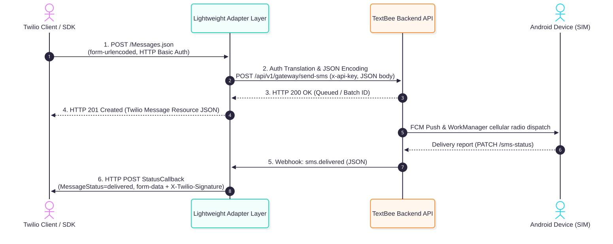
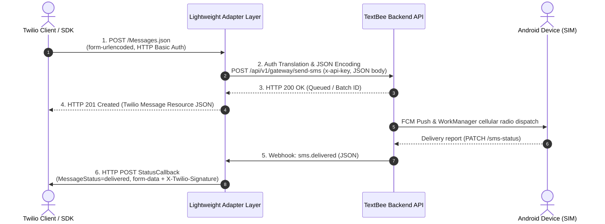

# Twilio to TextBee Endpoint Mapping

This document details the architectural routing and mapping table that connects the Twilio Programmable Messaging endpoints to the corresponding TextBee backend operations.

---

## 1. Master Routing & Translation Table

| Twilio Method & Path | TextBee Method & Path | TextBee Controller & Service Handler | Adapter Transformation Summary | Compatibility Status | Detailed Spec Link |
|---|---|---|---|:---:|:---:|
| `POST /2010-04-01/Accounts/{AccountSid}/Messages.json` | `POST /api/v1/gateway/send-sms` | `GatewayController.sendSMSWithoutDevice` $\to$ `GatewayService.sendSMSDeviceless` | 1. Parse `application/x-www-form-urlencoded`. 2. Translate `To` into `recipients: [To]`. 3. Translate `Body` into `message`. 4. Resolve `From` to `deviceId` & `simSubscriptionId`. 5. Map `StatusCallback` to adapter tracking state. 6. Wrap response in Twilio Message instance JSON (`status: queued`, `201 Created`). | **Adapter Required** | [04-send-sms.md](./endpoint-details/04-send-sms.md) |
| `GET /2010-04-01/Accounts/{AccountSid}/Messages/{MessageSid}.json` | `GET /api/v1/gateway/devices/:deviceId/sms/:smsId` OR `GET /api/v1/gateway/messages?search={smsId}` | `GatewayController.getSMS` $\to$ `GatewayService.getSMSById` OR `GatewayController.getMessages` | 1. Extract `smsId` from `MessageSid`. 2. Retrieve device ID from adapter mapping cache or query unified history `GET /messages`. 3. Translate TextBee status (`pending`, `dispatched`, `sent`, `delivered`, `failed`) into Twilio status. 4. Format RFC 2822 timestamps and return Twilio instance JSON. | **Adapter Required** | [05-retrieve-sms.md](./endpoint-details/05-retrieve-sms.md) |
| `GET /2010-04-01/Accounts/{AccountSid}/Messages.json` | `GET /api/v1/gateway/messages` | `GatewayController.getMessages` $\to$ `GatewayService.getMessagesForUser` | 1. Translate `To` $\to$ `search`, `From` $\to$ `search`. 2. Translate `DateSent<`, `DateSent>` $\to$ `to`, `from`. 3. Convert 0-indexed `Page` to 1-indexed `page`. 4. Map response message list into Twilio envelope with `first_page_uri`, `next_page_uri`, `previous_page_uri`. | **Adapter Required** | [06-list-sms.md](./endpoint-details/06-list-sms.md) |
| *Inbound Webhook to Customer App* (`POST <CustomerInboundUrl>`) | `POST /api/v1/gateway/devices/:id/receive-sms` $\to$ Webhook `sms.received` | `SMSReceivedWorker` (Android) $\to$ `GatewayController.receiveSMS` $\to$ `WebhookService.deliverNotification` | 1. Receive TextBee JSON webhook or intercept incoming ingest. 2. Format payload as `application/x-www-form-urlencoded`. 3. Generate `MessageSid`, populate `From`, `To`, `Body`, `NumMedia=0`. 4. Sign request with Twilio standard `X-Twilio-Signature`. | **Adapter Required** | [07-inbound-sms.md](./endpoint-details/07-inbound-sms.md) |
| *Delivery StatusCallback to Customer App* (`POST <CustomerCallbackUrl>`) | `PATCH /api/v1/gateway/devices/:id/sms-status` $\to$ Webhooks `sms.*` | `SMSStatusUpdateWorker` (Android) $\to$ `GatewayController.updateSMSStatus` $\to$ `WebhookService` | 1. Intercept status transitions (`sent`, `delivered`, `failed`). 2. Construct Twilio status payload (`MessageStatus`, `MessageSid`, `ErrorCode`). 3. Dispatch HTTP POST to original `StatusCallback` URL recorded at message creation time. | **Adapter Required** | [08-status-callbacks.md](./endpoint-details/08-status-callbacks.md) |
| `POST /2010-04-01/Accounts/{AccountSid}/Messages/{MessageSid}.json` | *None* | *No native TextBee handler* | **Unsupported in Core**: Adapter can intercept queued messages in adapter-level queue and cancel before FCM dispatch. | **Unsupported / Custom** | [03-endpoint-mapping.md#unsupported-endpoints](#3-unsupported-endpoints--technical-rationale) |
| `DELETE /2010-04-01/Accounts/{AccountSid}/Messages/{MessageSid}.json` | *None* | *No native TextBee handler* | **Unsupported in Core**: TextBee retains audit logs for billing. Adapter can return `204 No Content` synthetically. | **Unsupported / Mocked** | [03-endpoint-mapping.md#unsupported-endpoints](#3-unsupported-endpoints--technical-rationale) |

---

## 2. Inbound & Outbound Data Flow Topology

Click to view Mermaid source

---

## 3. Unsupported Endpoints & Technical Rationale

### 3.1 Message Update (`POST /Messages/{MessageSid}.json`)
- **Twilio Functionality:** Allows canceling messages with `Status=canceled` while in `queued` state, or redacting message text (`Body=""`).
- **TextBee Reality:** Once a message is enqueued in TextBee's Bull queue (`sms-send`), Bull automatically executes jobs at wave intervals. There is no API route in `GatewayController` to remove an individual message from a pending batch or wipe the database record text.
- **Feasibility:** If needed in Phase 3, this can only be achieved by adding an adapter-level delayed queue or modifying TextBee's `GatewayService`.

### 3.2 Message Deletion (`DELETE /Messages/{MessageSid}.json`)
- **Twilio Functionality:** Permanently removes message metadata and attachments from the Twilio account.
- **TextBee Reality:** TextBee does not expose an endpoint to delete individual messages. Deletion is restricted to full device records (`DELETE /gateway/devices/:id`), and historical messages are retained for billing/quota reconciliations.
- **Feasibility:** Adapter can return HTTP `204 No Content` to satisfy SDK expectations while leaving TextBee records intact, or record a soft-deletion tombstone in the adapter layer.

