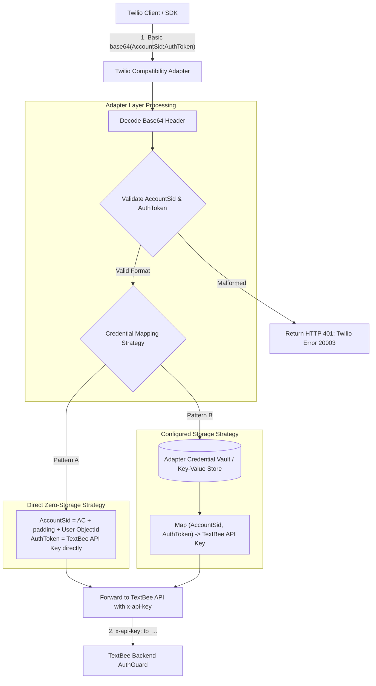

# Authentication & Authorization Translation

This document specifies how authentication and credential verification are bridged between the **Twilio Programmable Messaging API** and the **TextBee Platform**.

---

## 1. Authentication Schemes Compared

| Dimension | Twilio Programmable Messaging | TextBee Platform |
|---|---|---|
| **Mechanism** | HTTP Basic Authentication (`Authorization: Basic ...`) | Custom Header (`x-api-key`) OR Query Parameter (`?apiKey=`) |
| **Credential Components** | 1. **Username:** `AccountSid` (`AC` + 32 hex characters)<br/>2. **Password:** `AuthToken` (32-character secret) | Single API Key string (e.g. `tb_live_...` or hex string) |
| **Storage & Lookup** | Centralized Twilio account credentials | Hashed in MongoDB: deterministic SHA-256 index (`hashedApiKeySha256`) + legacy bcrypt |
| **User Context Attachment** | Resolves `AccountSid` to customer account | Resolves API key to `User` document and attaches to `req.user` |
| **Failure Response** | HTTP `401 Unauthorized` with Twilio error code `20003` | HTTP `401 Unauthorized` with `{ "success": false, "message": "Unauthorized" }` |

---

## 2. Authentication Translation Architecture



<details>
<summary>Click to view Mermaid source</summary>


</details>

---

## 3. Recommended Credential Mapping Strategies

### Pattern A: Direct Zero-Storage Derivation (Recommended for Simplicity)
To eliminate the requirement for an auxiliary database in the compatibility layer:
1. **Account SID Synthesis:**
   A MongoDB `User._id` is a 24-character hexadecimal string. A Twilio `AccountSid` is 34 characters starting with `AC`.
   $$\text{AccountSid} = \text{"AC00000000"} + \text{user.\_id}$$
   - Prefix: `AC` (2 chars)
   - Padding: `00000000` (8 chars)
   - Unique ID: `user._id` (24 chars)
   - Total: exactly 34 characters, indistinguishable from a standard Twilio Account SID.
2. **Auth Token Mapping:**
   The customer uses their raw TextBee API Key directly as the `AuthToken`.
3. **Execution:**
   - The adapter extracts the password from the HTTP Basic Auth header.
   - The adapter verifies that the username matches `AC00000000{userId}`.
   - The adapter forwards the password directly as the `x-api-key` header to TextBee.

### Pattern B: Managed Key Vault (For Custom Multi-User Credentials)
If an enterprise requires independent Twilio sub-accounts or rotated API Keys:
1. The adapter maintains a lightweight database table:
   ```sql
   CREATE TABLE twilio_credentials (
       account_sid VARCHAR(34) PRIMARY KEY,
       auth_token_hash VARCHAR(64) NOT NULL,
       textbee_api_key VARCHAR(128) NOT NULL,
       created_at TIMESTAMP DEFAULT CURRENT_TIMESTAMP
   );
   ```
2. When a request arrives, the adapter performs a constant-time HMAC comparison of `AuthToken`, resolves the corresponding `textbee_api_key`, and attaches it as `x-api-key`.

---

## 4. Error Normalization

When authentication fails at the adapter or is rejected by TextBee:

#### Twilio Rejection Payload (`401 Unauthorized`):
```json
{
  "code": 20003,
  "message": "Authentication Error - No credentials provided or invalid AccountSid/AuthToken",
  "more_info": "https://www.twilio.com/docs/errors/20003",
  "status": 401
}
```

The adapter must never leak TextBee's internal error format (`{ "statusCode": 401, "message": "Unauthorized" }`) to client SDKs, as official Twilio libraries (such as `twilio-python`, `twilio-node`, `twilio-csharp`) inspect `error.code === 20003` to raise typed authentication exceptions.

