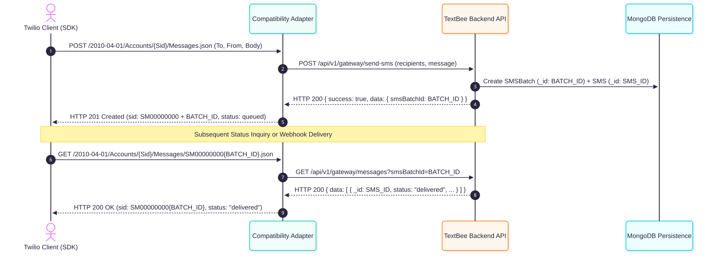
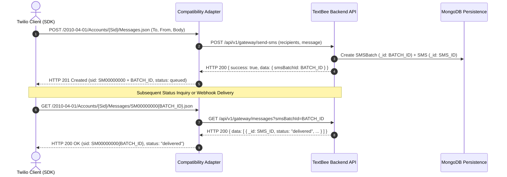

# Message Identifier Mapping & Reconciliation

This document analyzes the technical structure, encoding differences, and bi-directional reconciliation mechanics between **Twilio Message SIDs** and **TextBee MongoDB ObjectIds**.

---

## 1. Identifier Formats Compared

| Dimension | Twilio Message SID | TextBee Message ID (`_id` / `smsId` / `smsBatchId`) |
|---|---|---|
| **Length** | Exactly 34 characters | Exactly 24 characters |
| **Prefix** | `SM` (Standard SMS) or `MM` (MMS) | None (pure hexadecimal) |
| **Character Set** | Case-insensitive hexadecimal characters (`[0-9a-fA-F]`) | Lowercase hexadecimal characters (`[0-9a-f]`) |
| **Format Regex** | `^SM[0-9a-fA-F]{32}$` | `^[0-9a-f]{24}$` |
| **SDK Validation** | Official Twilio SDKs (`twilio-python`, `twilio-node`, `twilio-csharp`) validate SID format before sending requests. | Mongoose `Types.ObjectId.isValid()` checks 24 hex chars. |
| **Generation Origin** | Cloud API Edge upon request ingress | MongoDB server / Mongoose ODM upon record persistence |

---

## 2. Reversible Stateless Reconciliation Strategy

To avoid introducing an auxiliary database or stateful storage layer in the compatibility adapter, the adapter employs **Deterministic Zero-Pad Framing**.

### 2.1 Encoding: TextBee ObjectId $\longrightarrow$ Twilio Message SID
Given a 24-character TextBee MongoDB ObjectId:
$$\text{ObjectId} = \text{"65cb888888880fedcba98765"}$$

The adapter synthesizes a compliant 34-character Twilio SID by prepending the literal prefix `"SM"` followed by eight zeroes (`"00000000"`):

$$\text{Twilio SID} = \text{"SM"} + \text{"00000000"} + \text{ObjectId}$$
$$\text{Result: } \text{"SM0000000065cb888888880fedcba98765"}$$

- **Twilio SDK Compatibility:** The synthesized string begins with `SM`, has a total length of 34, contains only valid hexadecimal characters, and satisfies all official Twilio SDK validation checks.
- **Determinism:** The same TextBee ObjectId always yields the identical Twilio SID.

### 2.2 Decoding: Twilio Message SID $\longrightarrow$ TextBee ObjectId
When an incoming request arrives from a Twilio client (such as `GET /Messages/SM0000000065cb888888880fedcba98765.json`):

1. The adapter checks that the string matches `^SM00000000[0-9a-fA-F]{24}$`.
2. Strips the 10-character header (`"SM00000000"`).
3. Recovers the exact 24-character TextBee MongoDB ObjectId:
   $$\text{ObjectId} = \text{sid.slice(10)} = \text{"65cb888888880fedcba98765"}$$
4. Passes the raw 24-character ObjectId to TextBee queries (`GET /gateway/messages?search={objectId}` or `GET /gateway/devices/:id/sms/{objectId}`).

---

## 3. Handling `smsBatchId` vs. `smsId`

A critical idiosyncrasy discovered in Phase 1 ([`GW-01`](file:///e:/projects/textbee/docs/textbee-api-analysis/api-endpoints/sms-messaging.md#1-post-apiv1gatewaysend-sms)) is that TextBee's outbound endpoint `POST /gateway/send-sms` returns an `smsBatchId`, whereas individual recipient records in the `SMS` collection carry their own `_id` (`smsId`).

Click to view Mermaid source

### Resolution Rules:
1. **Immediate Outbound Response:** Because Twilio clients send 1 recipient per `POST Messages.json` call, the `SMSBatch` contains exactly 1 underlying `SMS` document. Returning `SM00000000{smsBatchId}` as the message SID is valid and stable.
2. **Subsequent Status Callbacks:** TextBee's `sms.*` webhook notifications carry both `data._id` (the individual `smsId`) and `data.smsBatch` (the batch ID). The adapter maps status callbacks using the `smsBatch` ID, ensuring exact correspondence with the SID initially returned to the client.
3. **Retrieval Queries:** The adapter queries `GET /api/v1/gateway/messages?smsBatchId={id}`, retrieving the exact recipient record and status history.

