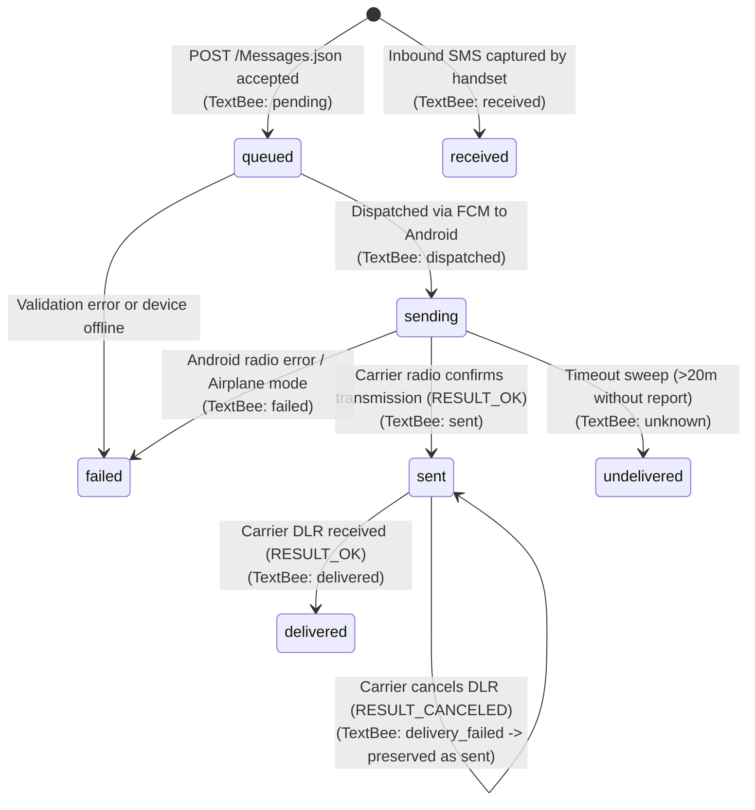

# Message Lifecycle & Status Transition Alignment

This document details the state machine alignment and lifecycle transition mapping between the **Twilio Programmable Messaging API** and the **TextBee Android SMS Gateway**.

---

## 1. State Machine Alignment Overview

Click to view Mermaid source

---

## 2. Status Transition Matrix

| Twilio Message Status | TextBee State (`SMS.status`) | Trigger Event in Architecture | Is Terminal? | Twilio ErrorCode Assigned? | Notes |
|---|---|---|:---:|:---:|---|
| **`queued`** | `pending` | Request accepted; record persisted in MongoDB; Bull job waiting | No | *None* | Initial status returned on `POST /Messages.json` (HTTP 201). |
| **`sending`** | `dispatched` | Bull queue worker executes; FCM data message pushed to Google; Android WorkManager receives task | No | *None* | Message in transit to device radio. |
| **`sent`** | `sent` | Android `SmsManager` reports `Activity.RESULT_OK` via `SMSStatusReceiver.kt` | No | *None* | Cellular tower accepted baseband transmission. |
| **`delivered`** | `delivered` | Mobile carrier delivery intent reports `Activity.RESULT_OK` | **Yes** | *None* | Target recipient handset acknowledged receipt. |
| **`undelivered`** | `unknown` | `SmsStatusUpdateTask.ts` sweeps messages pending/dispatched for $>20$ min | **Yes** | `30008` / `30003` | Handset unacknowledged or dropped push during sleep. |
| **`failed`** | `failed` | Pre-radio permission denial, modem rejection, airplane mode, or out of credit | **Yes** | `30001`–`30008` | Accompanied by mapped numeric Twilio error code. |
| **`received`** | `received` | Android `SMSBroadcastReceiver.kt` captures inbound cellular transmission | **Yes** | *None* | Inbound messages only. |

---

## 3. Asynchronous Behavior & Telco Idiosyncrasies

### 3.1 Non-Downgrade Delivery Report Behavior
A notable behavior discovered in Phase 1 ([`errors-and-statuses.md`](file:///e:/projects/textbee/docs/textbee-api-analysis/errors-and-statuses.md#4-delivery-report-nuances--issue-history)) is how TextBee handles canceled delivery reports:
- Many mobile network operators (especially MVNOs or prepaid SIMs) do not support delivery acknowledgments and cancel the pending intent (`Activity.RESULT_CANCELED`).
- If a message has already been confirmed as `sent` by the radio, receiving a canceled delivery report in TextBee does **not** revert the message to `failed`.
- The status remains `sent`, and an audit entry is recorded in `issueHistory`.
- **Adapter Alignment:** In Twilio, messages sent to carriers that do not provide DLR stay in the `sent` status indefinitely. This aligns with TextBee's native behavior, requiring no artificial status downgrade.

### 3.2 Late Arrival Recovery
If an Android handset is disconnected from cellular signal or enters deep OEM Doze sleep:
- The backend sweeper moves stale messages to `unknown` after 20 minutes (mapped to Twilio `undelivered`).
- If the handset later reconnects and successfully transmits the message, the Android app sends a late `PATCH /sms-status`.
- TextBee re-promotes the status from `unknown` to `sent` or `delivered`.
- **Adapter Alignment:** If a customer application registered a `StatusCallback`, the adapter emits an updated callback reflecting the late `delivered` state.

