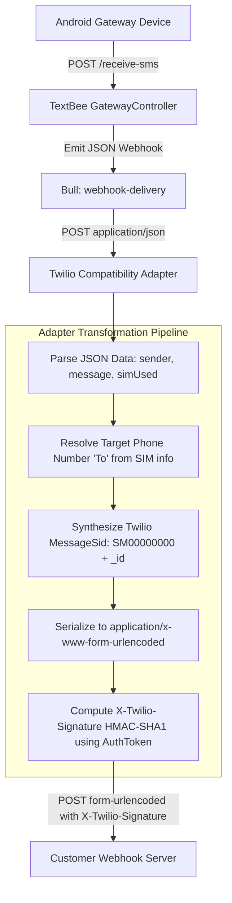

# Webhook & Event Dispatch Compatibility

This document provides a comprehensive technical comparison and translation architecture between **Twilio Webhooks** (Inbound SMS and StatusCallbacks) and **TextBee Webhook Notifications**.

---

## 1. Webhook Protocol Comparison

| Dimension | Twilio Webhook Protocol | TextBee Webhook Protocol |
|---|---|---|
| **Content-Type** | `application/x-www-form-urlencoded` | `application/json` |
| **HTTP Method** | `POST` (Standard; configurable to `GET`) | `POST` |
| **Signature Header** | `X-Twilio-Signature` | `x-textbee-signature-v2` (and legacy `x-textbee-signature`) |
| **Signature Algorithm** | **HMAC-SHA1** over full URL + alphabetically sorted POST parameters, base64 encoded | **HMAC-SHA256** over `${timestamp}.${rawBody}`, hex encoded |
| **Registration Scope** | **Dynamic Per-Request** (`StatusCallback` parameter) OR **Per-Number** (Inbound Webhook) | **Global Per-Account** (`POST /webhook/subscriptions`) |
| **Retry Policy** | Up to 3 attempts with exponential backoff | 5 attempts via Bull queue `webhook-delivery` with exponential backoff |

---

## 2. Inbound SMS Webhook Translation

When TextBee receives an incoming message on an Android device, it dispatches an `sms.received` JSON event. The adapter translates this event into an official Twilio Inbound Webhook payload:


<details>
<summary>Click to view Mermaid source</summary>


</details>

### 2.1 Payload Parameter Translation

```text
TextBee JSON (sms.received)                     Twilio Form Data (POST)
─────────────────────────────────────────────   ──────────────────────────────────────────────────
data._id                          ───────►      MessageSid / SmsSid (SM00000000 + data._id)
user.accountSid (derived)         ───────►      AccountSid (AC00000000 + user._id)
data.sender                       ───────►      From (e.g. +12025550177)
simUsed.number (or device phone)  ───────►      To (e.g. +12025550144)
data.message                      ───────►      Body
"0"                               ───────►      NumMedia
"1"                               ───────►      NumSegments
"received"                        ───────►      SmsStatus
"2010-04-01"                      ───────►      ApiVersion
simUsed.countryIso                ───────►      FromCountry / ToCountry
```

---

## 3. Outbound Delivery StatusCallback Translation

When an outbound SMS changes state in TextBee (`sms.sent`, `sms.delivered`, `sms.failed`), the adapter intercepts the notification and delivers a Twilio-compliant status callback:

### 3.1 StatusCallback Payload Structure
```text
POST /customer/status-callback HTTP/1.1
Host: customer-app.com
Content-Type: application/x-www-form-urlencoded
X-Twilio-Signature: q8J1K2L3M4N5O6P7Q8R9S0T1U2V=

AccountSid=AC0000000064bf800100010fedcba98765
ApiVersion=2010-04-01
From=%2B12025550144
MessageSid=SM0000000065cb76543210fedcba987654
MessageStatus=delivered
SmsSid=SM0000000065cb76543210fedcba987654
SmsStatus=delivered
To=%2B12025550199
```

If delivery failed, the adapter appends:
```text
ErrorCode=30003
ErrorMessage=Unreachable+destination+handset
```

---

## 4. `X-Twilio-Signature` Generation Algorithm

To ensure customer applications using official Twilio SDK validator utilities (e.g., `RequestValidator` in `twilio-python` or `twilio-node`) accept the adapter's webhooks without error, the adapter must compute the cryptographic signature:

```typescript
import * as crypto from 'crypto';

export function computeTwilioSignature(
  authToken: string,
  url: string,
  params: Record<string, string>
): string {
  // 1. Sort the POST parameter keys alphabetically
  const sortedKeys = Object.keys(params).sort();

  // 2. Concatenate the URL and each key-value pair in order
  let data = url;
  for (const key of sortedKeys) {
    data += key + params[key];
  }

  // 3. Compute HMAC-SHA1 using the customer's AuthToken
  return crypto
    .createHmac('sha1', authToken)
    .update(Buffer.from(data, 'utf-8'))
    .digest('base64');
}
```
This guarantees 100% compliance with Twilio webhook verification middleware (`validate_request` / `webhook` guards).
