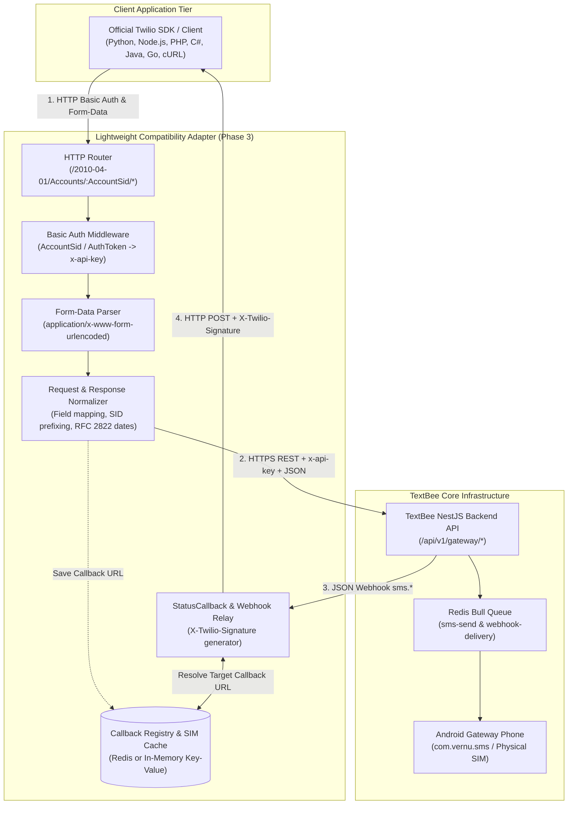

# Lightweight Compatibility Adapter Requirements (Phase 3 Blueprint)

This document specifies the architectural blueprint, minimal responsibilities, state management requirements, and security controls for the future **Phase 3 Twilio Compatibility Adapter Layer**.

---

## 1. Conceptual Architecture

The compatibility adapter is designed as a lightweight reverse-proxy / protocol-translation facade:

Click to view Mermaid source

---

## 2. Functional Responsibilities Breakdown

### 2.1 Stateless Responsibilities (No Database Required)
The core adapter should remain completely stateless for 90% of operations:
1. **Authentication Translation:** Decodes HTTP Basic Authentication header, verifies that the username matches `AC00000000{userId}`, and injects the password into the `x-api-key` header forwarded to TextBee.
2. **Payload Serialization:** Parses incoming `application/x-www-form-urlencoded` payloads and constructs clean `application/json` request bodies.
3. **Field Normalization:** Maps `To` $\to$ `recipients: [To]`, `Body` $\to$ `message`, and `SendAt` $\to$ `scheduledAt`.
4. **Deterministic SID Reconciliation:** Encodes MongoDB 24-character hex ObjectIds into 34-character Twilio SIDs (`SM00000000` + ObjectId) and decodes them on fetch requests without database lookups.
5. **Timestamp & Pagination Serialization:** Converts ISO 8601 strings into RFC 2822 timestamps and synthesizes standard Twilio HATEOAS pagination links (`first_page_uri`, `next_page_uri`).
6. **Error Envelope Normalization:** Maps TextBee HTTP status codes and error strings into standard Twilio JSON error envelopes with numeric error codes (`20003`, `21211`, `21606`, `20429`, `20500`).

### 2.2 Stateful Responsibilities (Minimal Ephemeral Storage)
Only two capabilities require state persistence, which can be satisfied with a lightweight Redis instance or in-memory LRU cache:
1. **Per-Message `StatusCallback` Registry:**
   - Twilio allows callers to specify a unique `StatusCallback` URL on every individual `POST /Messages.json` request.
   - TextBee only dispatches events to globally configured webhook subscriptions.
   - **Requirement:** The adapter stores `(smsBatchId / smsId) -> StatusCallbackUrl` with a 48-hour Time-To-Live (TTL). When TextBee emits `sms.delivered` or `sms.failed`, the adapter retrieves the URL and executes the callback.
2. **Device / SIM Phone Number Cache:**
   - When a Twilio client calls `POST Messages.json` with a specific `From` phone number, the adapter resolves that phone number to a TextBee `deviceId` and `simSubscriptionId`.
   - **Requirement:** The adapter caches the output of `GET /gateway/devices` (refreshing every 10–30 minutes) to resolve phone numbers to device IDs instantaneously.

---

## 3. Technology Stack & Framework Recommendations

To ensure maximum performance, minimal footprint, and architectural harmony with the existing TextBee TypeScript codebase:

- **Runtime:** Node.js 20+ LTS or Bun.
- **Web Framework:** Express or Fastify (Fastify recommended for lower memory overhead and high JSON serialization speed).
- **HTTP Client:** `undici` or `axios` with keep-alive connection pooling.
- **Cache Store:** `ioredis` (sharing TextBee's existing Redis instance or running standalone).
- **Validation:** `zod` or `joi` for fast incoming form-data schema assertions.
- **Cryptographic Library:** Node.js native `crypto` module for `X-Twilio-Signature` HMAC-SHA1 calculation.

---

## 4. Security & Egress Isolation Requirements

1. **SSRF Protection on StatusCallbacks:**
   - Customers provide arbitrary URLs in the `StatusCallback` parameter.
   - **Mandatory Control:** The adapter must validate resolved IP addresses after DNS lookup and refuse connections to private or loopback subnets (`127.0.0.0/8`, `10.0.0.0/8`, `172.16.0.0/12`, `192.168.0.0/16`, `169.254.169.254`).
2. **Timing-Safe Credential Verification:**
   - Any local token or secret verification must use `crypto.timingSafeEqual` to eliminate side-channel timing attacks.
3. **Audit Log Sanitization:**
   - Never log raw API Keys or SMS plaintext content in production application logs.

