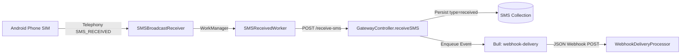

# Endpoint Mapping: Inbound SMS Webhook

## 1. Twilio Inbound Webhook Specification

When a third party sends an SMS to a customer's phone number, Twilio makes an HTTP request to the customer's configured webhook URL.

- **HTTP Method:** `POST` (Standard)
- **Transport:** Outgoing HTTP POST to Customer Server
- **Content-Type:** `application/x-www-form-urlencoded`
- **Security / Signature:** `X-Twilio-Signature` (HMAC-SHA1 of full URL + sorted POST parameters using the customer's `AuthToken`).

#### Payload Parameters:

| Parameter | Type | Example | Description |
|---|---|---|---|
| `MessageSid` | `string` | `SM65cb999999990fedcba98765` | Unique 34-character message identifier. |
| `SmsSid` | `string` | `SM65cb999999990fedcba98765` | Same as `MessageSid` (backward compatibility). |
| `AccountSid` | `string` | `ACXXXXXXXXXXXXXXXXXXXXXXXXXXXXXXXX` | Customer Account SID. |
| `From` | `string` | `+12025550177` | The mobile phone number that originated the SMS. |
| `To` | `string` | `+12025550144` | The destination gateway phone number (SIM MSISDN). |
| `Body` | `string` | `YES, confirm appointment` | The received SMS text body. |
| `NumMedia` | `string` | `0` | Number of media attachments (`0` for SMS). |
| `NumSegments` | `string` | `1` | Inbound carrier segment count. |
| `FromCity` | `string` | `Washington` | Optional geographic metadata. |
| `FromState` | `string` | `DC` | Optional geographic metadata. |
| `FromCountry` | `string` | `US` | Country code of sender. |

#### Expected Customer Response:
1. **Empty 200 OK:** Customer processes message without immediate reply.
2. **TwiML Response:** Customer responds with XML:
   ```xml
   <?xml version="1.0" encoding="UTF-8"?>
   <Response>
       <Message>Thank you! Your appointment is confirmed.</Message>
   </Response>
   ```

---

## 2. TextBee Inbound Messaging Pipeline

In TextBee, inbound SMS reception occurs across two decoupled tiers:


<details>
<summary>Click to view Mermaid source</summary>


</details>

- **Handset Ingest Route:** `POST /api/v1/gateway/devices/:deviceId/receive-sms` ([`GW-08`](file:///e:/projects/textbee/docs/textbee-api-analysis/api-endpoints/sms-messaging.md#8-post-apiv1gatewaydevicesidreceive-sms))
- **Outbound Webhook Event:** `sms.received`
- **TextBee Outbound Webhook Format:**
  - Content-Type: `application/json`
  - Signature Header: `x-textbee-signature-v2: t=<timestamp>,v1=<hex_hmac>`
  - Payload Schema:
    ```json
    {
      "event": "sms.received",
      "data": {
        "_id": "65cb999999990fedcba98765",
        "device": "64bf800100010fedcba98765",
        "sender": "+12025550177",
        "message": "YES, confirm appointment",
        "receivedAt": "2026-03-01T14:15:00.000Z",
        "type": "received",
        "status": "received",
        "simUsed": {
          "subscriptionId": 1,
          "slotIndex": 0,
          "carrierName": "T-Mobile"
        }
      }
    }
    ```

---

## 3. Compatibility Analysis & Adapter Bridge

### 3.1 Webhook Translation Bridge
To reproduce the Twilio inbound experience, the adapter functions as an intermediary webhook listener:
1. **Registration:** During customer onboarding, the adapter registers its internal endpoint as a Webhook Subscription on the user's TextBee account for event `sms.received` via `POST /api/v1/webhook/subscriptions`.
2. **Payload Transformation:** When TextBee dispatches `sms.received`, the adapter:
   - Resolves the target destination phone number (`To`) from the `device.simInfo` matching `simUsed.subscriptionId`.
   - Formats the body as `application/x-www-form-urlencoded`:
     ```text
     MessageSid=SM65cb999999990fedcba98765&SmsSid=SM65cb999999990fedcba98765&AccountSid=AC...&From=%2B12025550177&To=%2B12025550144&Body=YES%2C+confirm+appointment&NumMedia=0&NumSegments=1
     ```
   - Signs the HTTP POST request using `X-Twilio-Signature` calculated with the customer's Twilio `AuthToken`.
   - Dispatches the HTTP POST to the customer's configured webhook URL.

### 3.2 TwiML Auto-Reply Processing
If the customer application responds with TwiML XML containing `<Message>...</Message>`:
- The adapter parses the XML root `<Response><Message>`.
- Extracts the response text string.
- Immediately calls `POST /api/v1/gateway/send-sms` back into TextBee, targeting the original sender (`recipients: [From]`) from the same device (`deviceId`).

---

## 4. Implementation Feasibility

| Assessment | Details |
|---|---|
| **Feasibility Level** | **Adapter Required (High Feasibility)** |
| **Prerequisites** | 1. Inbound webhook receiver listening for TextBee `sms.received`.<br/>2. Outbound HTTP client with `X-Twilio-Signature` HMAC-SHA1 calculation.<br/>3. Optional XML parser for TwiML auto-replies. |
| **Backend Changes Required?** | None. Completely supported by existing TextBee webhook fan-out. |

