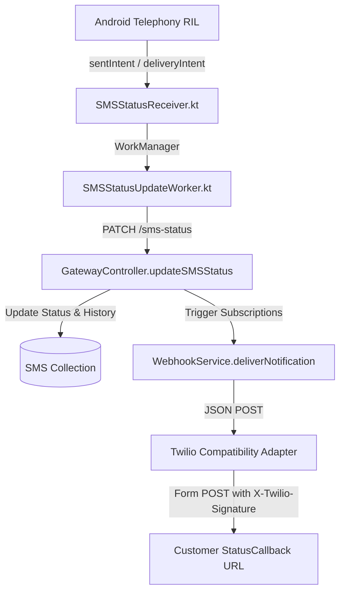

# Endpoint Mapping: Delivery Status Callbacks

## 1. Twilio StatusCallback Specification

When an outbound message is created with a `StatusCallback` parameter, Twilio dispatches an asynchronous HTTP POST request to that URL whenever the delivery state changes.

- **HTTP Method:** `POST`
- **Transport:** Outgoing HTTP POST to Customer Server
- **Content-Type:** `application/x-www-form-urlencoded`
- **Signature:** `X-Twilio-Signature` (HMAC-SHA1)

#### Status Progression:
$$\text{queued} \longrightarrow \text{sending} \longrightarrow \text{sent} \longrightarrow \text{delivered} \;\big(\text{or } \text{undelivered} \;/\; \text{failed}\big)$$

#### Payload Parameters:

| Parameter | Type | Example | Description |
|---|---|---|---|
| `MessageSid` | `string` | `SM65cb888888880fedcba98765` | Unique identifier of the message. |
| `MessageStatus` | `string` | `delivered` | Current lifecycle state: `queued`, `sending`, `sent`, `delivered`, `undelivered`, `failed`. |
| `SmsSid` | `string` | `SM65cb888888880fedcba98765` | Same as `MessageSid`. |
| `SmsStatus` | `string` | `delivered` | Same as `MessageStatus`. |
| `To` | `string` | `+12025550199` | Destination phone number. |
| `From` | `string` | `+12025550144` | Sender phone number. |
| `AccountSid` | `string` | `ACXXXXXXXXXXXXXXXXXXXXXXXXXXXXXXXX` | Twilio Account SID. |
| `ApiVersion` | `string` | `2010-04-01` | API version constant. |
| `ErrorCode` | `string` | `30003` | (Optional) Twilio error code if status is `undelivered` or `failed`. |
| `ErrorMessage` | `string` | `Unreachable destination handset` | (Optional) Description of the error. |

---

## 2. TextBee Status Pipeline & Events

In TextBee, status changes originate from Android telephony intents and are uploaded via Retrofit:

Click to view Mermaid source

- **Uplink Endpoint:** `PATCH /api/v1/gateway/devices/:deviceId/sms-status` ([`GW-07`](file:///e:/projects/textbee/docs/textbee-api-analysis/api-endpoints/sms-messaging.md#7-patch-apiv1gatewaydevicesidsms-status))
- **Webhook Events Emitted:**
  - `sms.sent`: Cellular radio confirmed transmission (`Activity.RESULT_OK`).
  - `sms.delivered`: Handset carrier received SMS-DELIVERY-REPORT PDU.
  - `sms.failed`: Radio failure, airplane mode, or terminal exception.

---

## 3. Compatibility Analysis & State Mapping

### 3.1 Status Alignment Table

| TextBee State & Event | Condition | Twilio `MessageStatus` | Twilio `ErrorCode` |
|---|---|:---:|:---:|
| Initial DB creation | Message persisted in MongoDB | `queued` | *None* |
| FCM dispatch | Enqueued in Android WorkManager | `sending` | *None* |
| `sms.sent` | Radio baseband transmitted (`RESULT_OK`) | `sent` | *None* |
| `sms.delivered` | Carrier delivery receipt confirmed | `delivered` | *None* |
| `sms.failed` (`RADIO_OFF`) | Android in airplane mode | `failed` | `30003` |
| `sms.failed` (`NO_SERVICE`) | Handset has no cellular tower reception | `failed` | `30003` |
| `sms.failed` (`GENERIC_FAILURE`) | Modem rejected AT command / SIM out of credit | `failed` | `30008` |
| Sweeper Timeout (`unknown`) | >20 min without Android radio confirmation | `undelivered` | `30008` |
| `delivery_failed` (canceled) | Carrier omitted DLR (status kept as `sent`) | `sent` *(no downgrade)* | *None* |

### 3.2 Dynamic Callback Routing
Because TextBee webhooks are registered globally at the account level (`POST /webhook/subscriptions`), while Twilio clients specify callbacks dynamically per-request (`POST Messages.json` with `StatusCallback=...`):

1. **Storage of Callback URL:**
   When an external app calls `POST /Messages.json`, the adapter stores the association:
   $$\text{smsId} \longrightarrow \text{StatusCallbackUrl}$$
2. **Event Interception & Dispatch:**
   When the adapter receives an `sms.*` webhook notification from TextBee:
   - Matches `payload.data._id` to the stored `StatusCallbackUrl`.
   - Serializes the Twilio form-encoded payload (`MessageStatus`, `MessageSid`, `To`, `From`, `ErrorCode`).
   - Signs the request with `X-Twilio-Signature`.
   - Dispatches the HTTP POST to the customer's destination URL.

---

## 4. Implementation Feasibility

| Assessment | Details |
|---|---|
| **Feasibility Level** | **Adapter Required (High Feasibility)** |
| **Prerequisites** | 1. Persistent or in-memory key-value store mapping `(smsId -> callbackUrl)`. 2. Webhook listener receiving TextBee `sms.*` events. 3. Outbound webhook client with retry backoff and HMAC-SHA1 signing. |
| **Backend Changes Required?** | None. Fully supported by TextBee's existing webhook fan-out engine. |

